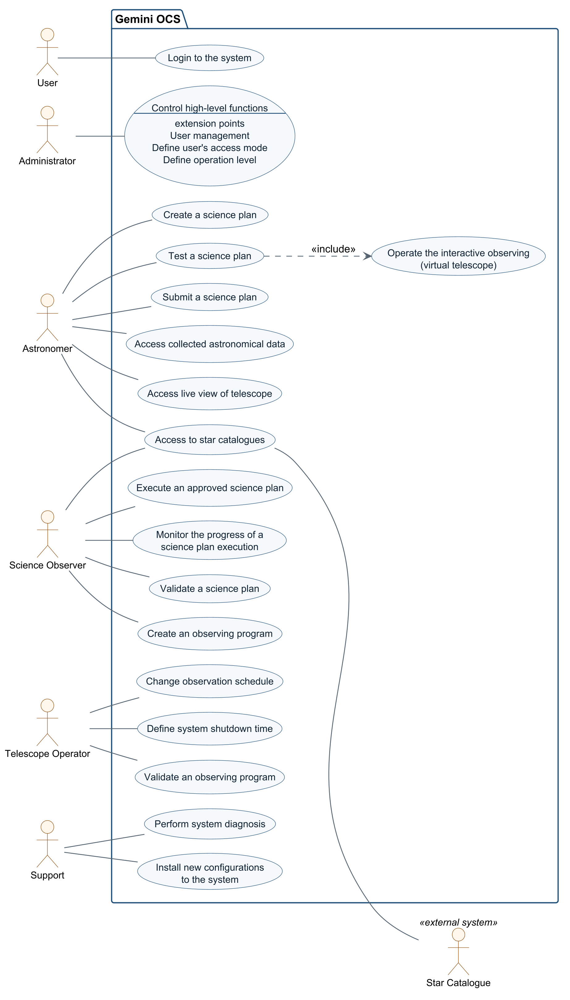

# Gemini Observatory Control System — Use Case Model

The model covers the user-facing part of the Gemini OCS: six actors, the external **Star Catalogue** system actor and eighteen use cases, from login to the data that the astronomer finally views.

Drawn with PlantUML 1.2026.9 (Smetana layout) from [`AZERTY_D2_Usecase.puml`](AZERTY_D2_Usecase.puml), rendered at `skinparam dpi 250`.
