## Use case Diagram

### Use Case 1: Submit & Validate Science Program

| Use Case Name: Submit & Validate Science Program                                                                                                                                                                                                                                                                                                                                                                                                                                                                                                                                                                                                                                                                                                                                                                                    |
|:------------------------------------------------------------------------------------------------------------------------------------------------------------------------------------------------------------------------------------------------------------------------------------------------------------------------------------------------------------------------------------------------------------------------------------------------------------------------------------------------------------------------------------------------------------------------------------------------------------------------------------------------------------------------------------------------------------------------------------------------------------------------------------------------------------------------------------|
| **Primary Actor:** Astronomer                                                                                                                                                                                                                                                                                                                                                                                                                                                                                                                                                                                                                                                                                                                                                                                                       |
| **Stakeholders and Interests: <ul>Astronomer:** <ul>Wants to submit valid science programs structured as Program, Observation, Sequence, and Step, receiving immediate confirmation of feasibility.</ul>  **External Scheduler:** <ul>Needs syntactically validated programs with expanded execution steps and recorded version tags for queue generation.</ul>  **Observatory Staff:** <ul>Wants to ensure no programs with unfixable physical conflicts reach the observing stage.</ul>                                                                                                                                                                                                                                                                                                                                           |
| **Brief Description:**	<ul> Allows an Astronomer to submit a science program. The system validates syntax and physical constraints, expands structured iterators into step lists, records the program version, and dispatches candidate observations to the external scheduler.</ul>**Precondition:** <ul>The Astronomer is authenticated and has authoring permissions.</ul>                                                                                                                                                                                                                                                                                                                                                                                                                                                        |
| **Trigger:**	<ul>The Astronomer clicks `Submit Program` from the Science Program interface.</ul>                                                                                                                                                                                                                                                                                                                                                                                                                                                                                                                                                                                                                                                                                                                                     |
| **Normal Flow of Events:** <ol> <li>The Astronomer enters the science program details structured into Program, Observation, Sequence, and Step. <li> The Astronomer clicks `Submit Program`. <li>The system parses the program structure and validates the syntax and command parameters. <li>The system expands structured iterators into an executable step list. <li>The system performs physical conflict validation. <li>The system records the program version to be executed and stamps the transaction with a UTC timestamp and originator ID.  <li>The system marks the program as Validated. <li>The system dispatches candidate observations to the External Scheduler interface.  <li>The system presents a submission receipt displaying the assigned Program ID and version label to the Astronomer.</ol>             |
| **Alternate/Exceptional Flow:** <ul><li>**3a/5a. Immediate Rejection on Fatal Conflict:** <ol> <li>The system detects invalid command syntax or an unfixable physical conflict. <li>The system rejects the program immediately without execution. <li>The system returns an error report to the Astronomer with validation flags.</ol> <li> **5b. Recoverable Issues Detected:** <ol><li> The system identifies non-fatal parameter deviations. <li>The system accepts the program, logs warning diagnostics, and marks the program status as Validated-WithWarnings. </ol> <li>**8a. Scheduler Interface Failure:** <ol><li>The external scheduler fails to handshake within timeout limits. <li>The system persists the program locally with status Validated-PendingDispatch, queues an automatic retry, and logs an alert.</ul> |

### Use Case 2: Manage & Reorder Nightly Queue

| Use Case Name: Manage & Reorder Nightly Queue                                                                                                                                                                                                                                                                                                                                                                                                                                                                                                                                                                                                                                                                                 |
|:------------------------------------------------------------------------------------------------------------------------------------------------------------------------------------------------------------------------------------------------------------------------------------------------------------------------------------------------------------------------------------------------------------------------------------------------------------------------------------------------------------------------------------------------------------------------------------------------------------------------------------------------------------------------------------------------------------------------------|
| **Primary Actor:** Telescope Operator                                                                                                                                                                                                                                                                                                                                                                                                                                                                                                                                                                                                                                                                                         |
| **Stakeholders and Interests: <ul>Telescope Operator:** <ul>Wants an adaptable, clear plan of execution that matches real-time weather and sky quality.</ul> **Astronomer:** <ul>Wants their observation executed under specified target atmospheric conditions. </ul>**Observatory Management:** <ul>Wants to maximize science shutter time and prevent telescope idling.</ul>                                                                                                                                                                                                                                                                                                                                               |
| **Brief Description:**	<ul>Allows the telescope operator to inspect, modify execution priority, manage scheduled observation blocks according to real-time weather and sky conditions.</ul> **Precondition:**	<ul>Nightly queue plan is loaded from the scheduler for the current UT date.</ul>                                                                                                                                                                                                                                                                                                                                                                                                                                 |
| **Trigger:**	<ul>The Telescope Operator needs to adjust the nightly observation queue due to changes in weather, sky conditions, priorities, or observing constraints.</ul>                                                                                                                                                                                                                                                                                                                                                                                                                                                                                                                                                    |
| **Normal Flow of Events:** <ol><li>The operator selects the next observation sequence from the active queue and commands execution. <li>System verifies enclosure safety interlocks and weather thresholds. <li>The system commands telescope mount to slew to target coordinates. <li>The system applies instrument optical configuration and filter settings. <li>The system engages guiding and tracking loop. <li>The system triggers exposure sequences and reads out raw CCD/detector data. <li>System packages metadata and pixel buffers into standard FITS format. <li>The system delivers FITS datasets to Data Handling & Archive System (DHS). <li>System marks observation block as completed in the queue.</ol> |
| **Alternate/Exceptional Flow:** <ul><li> **5a. Guide Star Acquisition Failure:** <ol><li>System fails to lock onto selected guide star within timeout limit. <li>System alerts Operator and pauses sequence. <li>Operator selects fallback guide star or triggers manual re-acquisition.                                                                                                                                                                                                                                                                                                                                                                                                                                      |

### Use Case 3: Execute Observation Sequence

| Use Case Name: Execute Observation Sequence                                                                                                                                                                                                                                                                                                                                                                                                                                                                                                                                                                                                                                                                                                                                                                                                                                                                         |
|:--------------------------------------------------------------------------------------------------------------------------------------------------------------------------------------------------------------------------------------------------------------------------------------------------------------------------------------------------------------------------------------------------------------------------------------------------------------------------------------------------------------------------------------------------------------------------------------------------------------------------------------------------------------------------------------------------------------------------------------------------------------------------------------------------------------------------------------------------------------------------------------------------------------------|
| **Primary Actor:** Telescope Operator                                                                                                                                                                                                                                                                                                                                                                                                                                                                                                                                                                                                                                                                                                                                                                                                                                                                               |
| **Stakeholders and Interests:** <ul>**Telescope Operator:** <ul>Relies on step-by-step sequencing, readiness checks, and direct subsystem commands.</ul> **Data Handling & Archive System (DHS):** <ul>Requires zero data loss and compliant FITS datasets containing all headers.</ul> **Safety Systems:** <ul>Requires physical safety interlocks and safe-state transitions upon danger.</ul>                                                                                                                                                                                                                                                                                                                                                                                                                                                                                                                    |
| **Brief Description:**	<ul>Orchestrates step-by-step execution. The system prepares actions at the same time, checks readiness, sends commands directly to controllers, collects detector data, creates FITS datasets, and updates execution records. </ul>**Precondition:**	<ul>Queue item selected; telescope mount, enclosure, and science instruments report nominal status.</ul>                                                                                                                                                                                                                                                                                                                                                                                                                                                                                                                                 |
| **Trigger:**	<ul>The Telescope Operator explicitly issues the command to execute the selected observation sequence.</ul>                                                                                                                                                                                                                                                                                                                                                                                                                                                                                                                                                                                                                                                                                                                                                                                             |
| **Normal Flow of Events:** <ol><li>The Operator commands execution of an observation sequence. <li>The system breaks down the sequence into individual execution steps. <li>For each step, the system issues independent preparation actions concurrently. <li>The system monitors controller handshaking. <li>The system checks that all target subsystems are ready before starting the exposure. <li>The system commands the detector subsystem to trigger exposure. <li>The system reads out detector buffers, packages pixel data with complete header information into FITS format, and validates according to FITS standards. <li>The system delivers the FITS dataset to the Data Handling & Archive System (DHS) ensuring zero data loss. <li>The system marks step execution progress. <li>Once all steps finish, the system marks the observation as complete and notifies the external scheduler. </ol> |
| **Alternate/Exceptional Flow: <ul><li>1a. Target-of-Opportunity (ToO) Interruption:** <ol><li>An authorized ToO interrupt is received. <li>The system safely suspends the active sequence and preserves the last completely acquired step. <li>Mount and beam are released to the high-priority target.</ol> <li>**3a. Inactive Instrument Beam Obstruction:** <ol><li>An inactive instrument component attempts motion that would obstruct the optical path. <li>The system blocks the movement or commands an uncoordinated offset to prevent beam blocking.</ol><li> **5a. Danger Condition Detected:** <ol><li>Sensor detects hazards. The system transitions mount and enclosure to a safe parked state.</ol></ul>                                                                                                                                                                                             |

### Use Case 4: Record Science Quality Verdict

| Use Case Name: Record Science Quality Verdict                                                                                                                                                                                                                                                                                                                                                                                                                                                                                                                                                                                                                                                                                                  |
|:-----------------------------------------------------------------------------------------------------------------------------------------------------------------------------------------------------------------------------------------------------------------------------------------------------------------------------------------------------------------------------------------------------------------------------------------------------------------------------------------------------------------------------------------------------------------------------------------------------------------------------------------------------------------------------------------------------------------------------------------------|
| **Primary Actor:** Science Observer                                                                                                                                                                                                                                                                                                                                                                                                                                                                                                                                                                                                                                                                                                            |
| **Stakeholders and Interests: <ul>Science Observer:** <ul>Wants to evaluate quick-look science frames, inspect seeing/SNR, and apply a formal quality verdict.</ul> **Telescope Operator:** <ul>Relies on recorded verdicts to determine whether sequence modifications are required.</ul> **External Scheduler:** <ul>Needs quality results to reduce or restore allocated partner time.</ul>                                                                                                                                                                                                                                                                                                                                                 |
| **Brief Description:**	<ul>The Science Observer inspects quick-look observation results and records a quality verdict against the observation. Quick-look sequence adjustments are handled automatically while major program adjustments are handled by the operator. </ul>**Precondition:**	<ul>The observation sequence has completed exposure readout and FITS previews are rendered.</ul>                                                                                                                                                                                                                                                                                                                                                    |
| **Trigger:**	<ul>The Science Observer opens a newly acquired observation step to record quality assessment.</ul>                                                                                                                                                                                                                                                                                                                                                                                                                                                                                                                                                                                                                                |
| **Normal Flow of Events:** <ol><li>The Science Observer accesses the quality assessment display. <li>The system retrieves the FITS dataset from fast local storage and displays the quick-look image with FWHM seeing and SNR metrics. <li>The Science Observer compares data quality against science program specifications. <li>The Science Observer selects a quality verdict. <li>The Science Observer enters evaluation comments and submits the verdict. <li>The system binds the verdict to the observation record and dataset metadata. <li>The system logs the event with a UTC timestamp and observer ID.   <li>The system relays the observation outcome to the external scheduler so remaining allocated time can be updated.</ol> |
| **Alternate/Exceptional Flow:  <ul><li>4a. Verdict Marked as Fail (Adverse Conditions):** <ol><li>The Science Observer assigns a Fail verdict due to cloud extinction or optical drift. <li>The system reports the unfulfilled execution time to the scheduler.     <li>The system flags the sequence for the Telescope Operator to decide whether to re-execute or reschedule.</ol><li> **2a. Concurrent Monitoring by Remote Users:** <ol><li>Additional science team members view the preview session remotely. <li>The system streams read-only previews without interfering with the observer's session.                                                                                                                                  |

### Use Case 5: Run Diagnostics & Subsystem Tests

| Use Case Name: Run Diagnostics & Subsystem Tests                                                                                                                                                                                                                                                                                                                                                                                                                                                                                                                                                                                                                                                                                    |
|:------------------------------------------------------------------------------------------------------------------------------------------------------------------------------------------------------------------------------------------------------------------------------------------------------------------------------------------------------------------------------------------------------------------------------------------------------------------------------------------------------------------------------------------------------------------------------------------------------------------------------------------------------------------------------------------------------------------------------------|
| **Primary Actor:** Support Staff                                                                                                                                                                                                                                                                                                                                                                                                                                                                                                                                                                                                                                                                                                    |
| **Stakeholders and Interests: <ul>Support Staff / Admin:** <ul>Needs modular diagnostic and testing tools for each subsystem to check equipment health.</ul> **Telescope Operator:** <ul>Relies on isolated diagnostics so tests do not abort exposures on healthy instruments.</ul> **Engineering Team:** <ul>Needs accurate baseline fault rates and telemetry drift measurements.</ul></ul>                                                                                                                                                                                                                                                                                                                                      |
| **Brief Description:**	<ul>Allows Support Staff/Admins to run diagnostic routines and test modules on designated subsystem interfaces, isolating failures to prevent disruption to healthy instruments, and logging baseline drift metrics.</ul> **Precondition:**	<ul>The target subsystem interface is connected; the subsystem is not engaged in an active science exposure.</ul>                                                                                                                                                                                                                                                                                                                                                  |
| **Trigger:**	<ul>The Support Staff member initiates a diagnostic self-test suite on a selected subsystem interface.</ul>                                                                                                                                                                                                                                                                                                                                                                                                                                                                                                                                                                                                             |
| **Normal Flow of Events:**  <ol><li>Support Staff selects a subsystem interface. <li>The system checks whether the selected subsystem is acquiring science data. <li>The system isolates the subsystem communication channel so tests do not affect other operational units. <li>The system sends general diagnostic tests to each subsystem.  <li>The subsystem answers status requests. <li>The system records actuator tolerances, sensor values, and response latency, comparing results against baseline fault rates. <li>The system compiles a Diagnostic Report marking the subsystem as Nominal. <li>The system returns the subsystem to standby mode and logs the diagnostic results with UTC timestamp and user identity. |
| **Alternate/Exceptional Flow: <ul><li>2a. Subsystem In Use by Active Sequence:** <ol><li>The target subsystem is in use by an active science exposure. <li>The system rejects the test request to protect active operations. </ol><li>**6a. Hardware Failure / Drift Detected:** <ol><li>Subsystem reports out-of-tolerance values or failures to respond within the handshake timeout. <li>The system isolates the failure, preventing it from crashing the middle layer or restarting hardware. <li>The system logs a fault alert, tries a software reconfiguration around the unit, and flags the status as Degraded/Fault.</ol></ul>                                                                                            |

## Activity Diagram

### Case 1

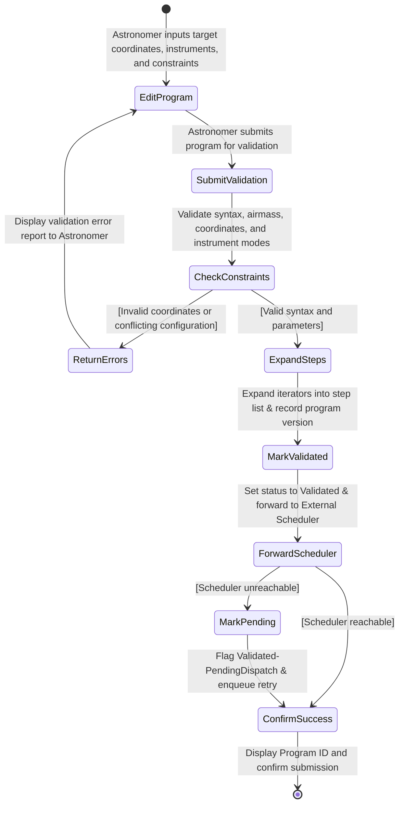

### Case 2

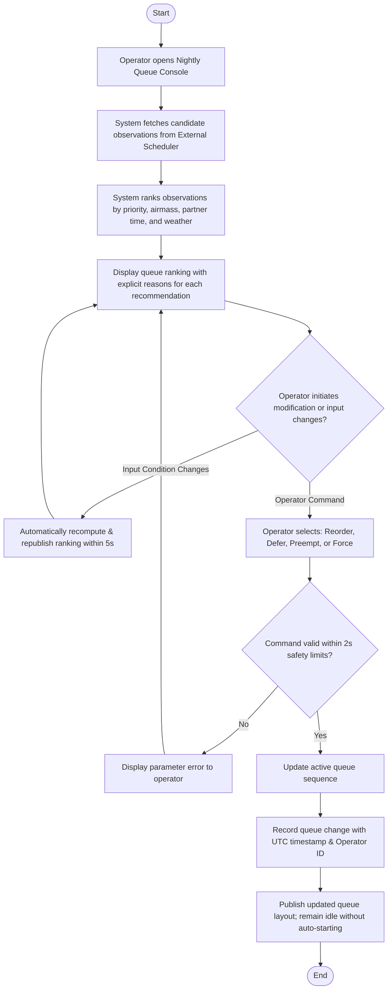

### Case 3

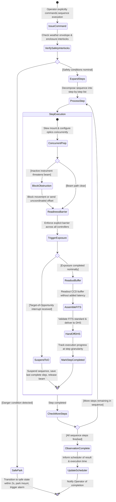

### Case 4

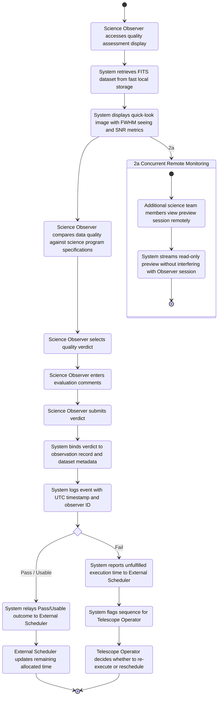

### Case 5

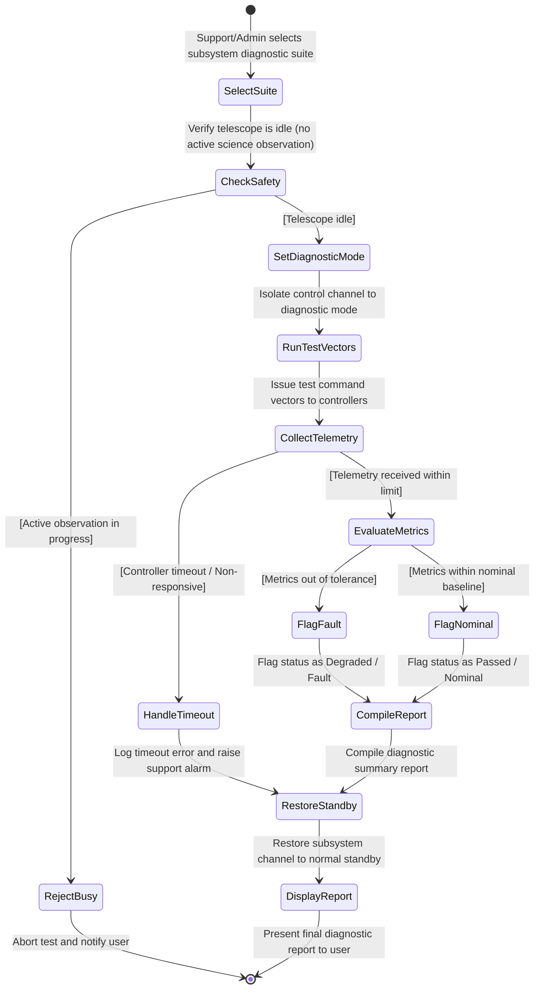

## Class Diagram

```mermaid
classDiagram
    class User {
        <<abstract>>
        #userID: String
        #name: String
        #role: String
        +login(): Boolean
        +logout(): void
    }

    class Astronomer {
        -institution: String
        +createProgram(): ScienceProgram
        +submitProgram(p: ScienceProgram): Boolean
    }

    class TelescopeOperator {
        -operatorLicenseId: String
        +reorderQueue(q: NightlyQueue, newOrder: List): void
        +confirmStart(seqId: String): void
        +handleToOInterrupt(seqId: String): void
    }

    class ScienceObserver {
        -qualificationLevel: String
        +inspectQuickLook(frame: DatasetFITS): void
        +submitVerdict(v: QAVerdict): void
    }

    class SupportStaff {
        -supportTier: String
        +runInterfaceDiagnostic(sub: SubsystemInterface): DiagnosticReport
        +reconfigureUnit(sub: SubsystemInterface): Boolean
    }

    class ScienceProgram {
        -programId: String
        -versionTag: String
        -title: String
        -status: String
        +submit(): Boolean
        +validateHierarchy(): Boolean
        +validatePhysicalConstraints(): Boolean
        +expandIterators(): List~ObservationStep~
        +recordVersion(): void
        +markValidated(status: String): void
        +dispatchToScheduler(): Boolean
        +getSubmissionReceipt(): String
    }

    class ValidationReport {
        -reportId: String
        -outcome: String
        -generatedAtUtc: DateTime
        +addFinding(code: String, severity: String, fieldRef: String): void
        +hasFatal(): Boolean
        +hasWarnings(): Boolean
        +toReceipt(): String
    }

    class NightlyQueue {
        -queueId: String
        -executionDate: Date
        -isLocked: Boolean
        -lastRankedAtUtc: DateTime
        +fetchRecommendations(): List~ObservationSequence~
        +rankObservations(): void
        +showRecommendationReasons(seqId: String): String
        +recomputeRanking(): void
        +updateOrder(reorderedList: List): Boolean
        +getNextRunnable(): ObservationSequence
        +markSequenceComplete(seqId: String): void
        +confirmStart(seqId: String): void
    }

    class ObservingConditions {
        -timestampUtc: DateTime
        -seeing: Double
        -cloudCover: Double
        -waterVapour: Double
        -skyBrightness: Double
        +refresh(): void
        +meetsConstraints(): Boolean
    }

    class ObservationSequence {
        -sequenceId: String
        -scientificPriority: Integer
        -remainingPartnerTime: Double
        -status: String
        -currentStepIndex: Integer
        +executeStepByStep(): void
        +suspendExecution(): void
        +commandSequence(seq: ObservationSequence): void
        +resumeFromLastStep(stepIndex: Integer): void
        +markComplete(): void
        +isFinished(): Boolean
    }

    class ObservationStep {
        -stepIndex: Integer
        -targetRA: Double
        -targetDec: Double
        -exposureTime: Double
        -opticalFilter: String
        -isCompleted: Boolean
        +prepareSubsystems(): void
        +enforceReadinessBarrier(): Boolean
        +markComplete(): void
        +restorePending(): void
    }

    class SubsystemInterface {
        -subsystemId: String
        -name: String
        -isIdle: Boolean
        -baselineFaultRate: Double
        -engineeringMode: Boolean
        +isolateChannel(): void
        +deliverCommandDirect(cmd: String): Boolean
        +queryStatus(): TelemetryData
        +getConfiguration(): Map
        +runTest(testId: String): TestResult
        +applyConfiguration(cfg: Map): Boolean
        +setEngineeringMode(on: Boolean): void
        +blockBeamObstructingAction(): void
        +transitionSafeState(): void
    }

    class DatasetFITS {
        -datasetId: String
        -filename: String
        -headerData: Map
        -utcStart: DateTime
        -deliveryState: String
        -fwhmSeeing: Double
        -snr: Double
        +assemble(rawBytes: Byte[], headers: Map): void
        +validateFITSStandard(): Boolean
        +handOffToDHS(): Boolean
        +retainUntilConfirmed(): void
        +releaseBackup(): void
        +computeQuickLookMetrics(): void
    }

    class QAVerdict {
        -verdictId: String
        -verdictValue: String
        -comments: String
        -evaluationTime: DateTime
        -observerId: String
        +record(): void
        +attachToDataset(ds: DatasetFITS): void
        +attachToSequence(seqId: String): void
        +logVerdict(): void
        +reportToScheduler(): void
        +flagSequence(seqId: String): void
    }

    class DiagnosticReport {
        -reportId: String
        -timestamp: DateTime
        -testerId: String
        -baselineDrift: Double
        -overallStatus: String
        +compileReport(): void
        +compareToBaseline(): void
        +flagFault(): void
        +flagNominal(): void
    }

    class HealthMonitor {
        -monitoredSubsystems: List~String~
        -heartbeatIntervals: Map
        -warningRates: Map
        +monitorHeartbeats(): void
        +classifyAnomaly(event: String): String
        +isolateFault(subsystemId: String): void
        +raiseAlarm(condition: String): void
        +proposeReconfiguration(): void
    }

    class AuditLog {
        -entryId: String
        -utcTimestamp: DateTime
        -originatorId: String
        -category: String
        -severity: String
        +log(action: String, originatorId: String, utc: DateTime): void
        +logAlarm(subsystemId: String, condition: String): void
        +logVerdict(verdictId: String, observerId: String, utc: DateTime): void
        +logDiagnostic(reportId: String, testerId: String, utc: DateTime): void
        +query(filter: String): List~Entry~
    }

    class ExternalSchedulerAdapter {
        -endpointUrl: String
        +dispatchProgram(p: ScienceProgram): Boolean
        +fetchQueuePlan(utDate: Date): List~ObservationSequence~
        +updateExecutionResult(seqId: String, timeUsed: Double, status: String): void
        +receiveVerdict(v: QAVerdict): Boolean
    }

    class DataHandlingArchiveSystem {
        -endpoint: String
        -linkState: String
        +acceptDataset(ds: DatasetFITS): Boolean
        +confirmSecureStorage(datasetId: String): Boolean
    }

    %% ---- Generalisation ----
    User <|-- Astronomer
    User <|-- TelescopeOperator
    User <|-- ScienceObserver
    User <|-- SupportStaff

    %% ---- US01 ----
    Astronomer "1" -- "0..*" ScienceProgram : authors
    ScienceProgram "1" -- "1..*" ValidationReport : produces
    ScienceProgram "1" -- "1" ExternalSchedulerAdapter : dispatches candidates

    %% ---- US02 ----
    TelescopeOperator "1" -- "0..*" NightlyQueue : manages
    NightlyQueue "1" o-- "0..*" ObservationSequence : organizes
    NightlyQueue -- ObservingConditions : ranks and re-ranks with
    NightlyQueue -- ExternalSchedulerAdapter : fetches nightly plan

    %% ---- US01 / US03 structure ----
    ScienceProgram "1" *-- "1..*" ObservationSequence : contains
    ObservationSequence "1" *-- "1..*" ObservationStep : decomposes into
    TelescopeOperator "1" -- "0..*" ObservationSequence : commands

    %% ---- US03 ----
    ObservationStep "1" -- "1..*" SubsystemInterface : commands directly
    ObservationStep "1" -- "0..*" DatasetFITS : generates
    DatasetFITS -- DataHandlingArchiveSystem : handed off to
    DataHandlingArchiveSystem -- DatasetFITS : confirms secure storage
    ObservationSequence -- ExternalSchedulerAdapter : reports outcome
    HealthMonitor "1" -- "1..*" SubsystemInterface : monitors

    %% ---- US04 ----
    ScienceObserver "1" -- "0..*" DatasetFITS : inspects quick-look
    ScienceObserver "1" -- "0..*" QAVerdict : submits
    DatasetFITS "1" -- "0..1" QAVerdict : annotated with
    ObservationSequence "1" -- "0..1" QAVerdict : judged by
    QAVerdict -- ExternalSchedulerAdapter : relays verdict

    %% ---- US05 ----
    SupportStaff "1" -- "0..*" SubsystemInterface : tests via modules
    SubsystemInterface "1" -- "0..*" DiagnosticReport : produces

    %% ---- Cross-cutting (all 5 UCs) ----
    ScienceProgram -- AuditLog : logs
    NightlyQueue -- AuditLog : logs
    ObservationSequence -- AuditLog : logs
    QAVerdict -- AuditLog : logs
    DiagnosticReport -- AuditLog : logs
    HealthMonitor -- AuditLog : logs
    AuditLog "0..*" -- "1" User : attributes action to
```

## Sequence Diagram

### Case 1

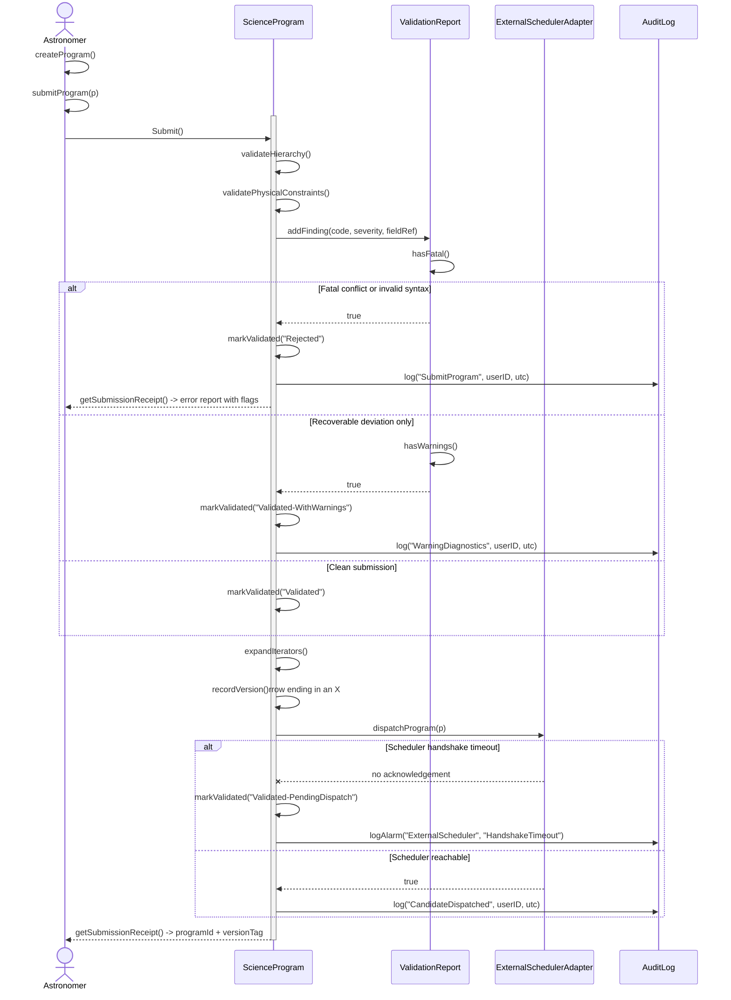

### Case 2

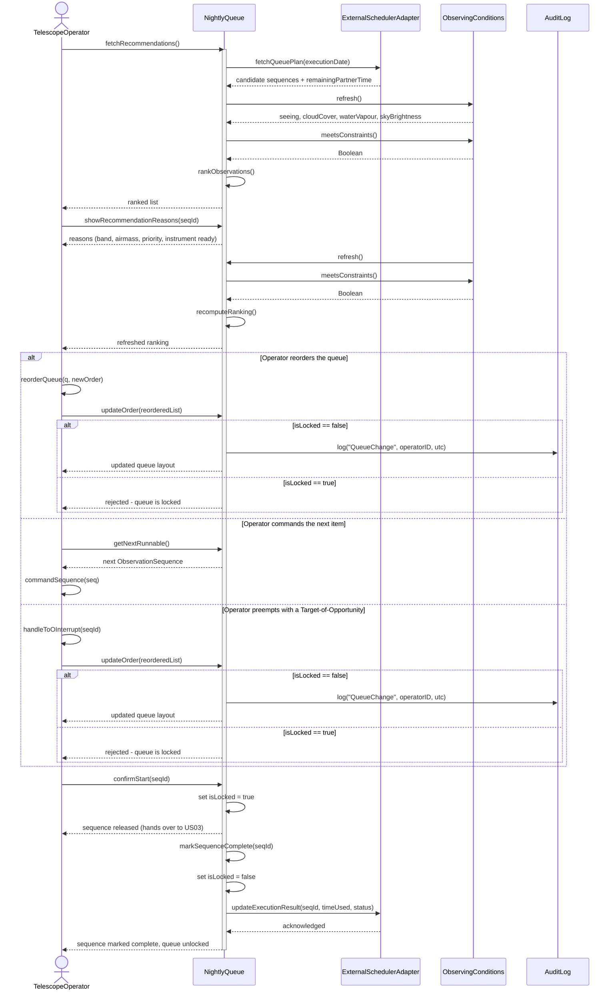

### Case 3
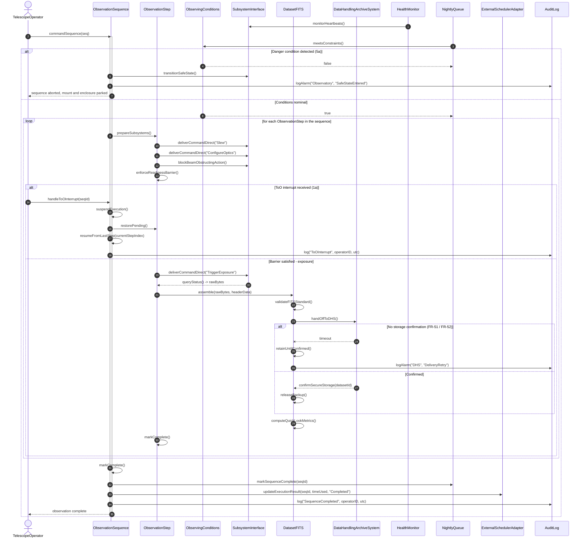

### Case 4
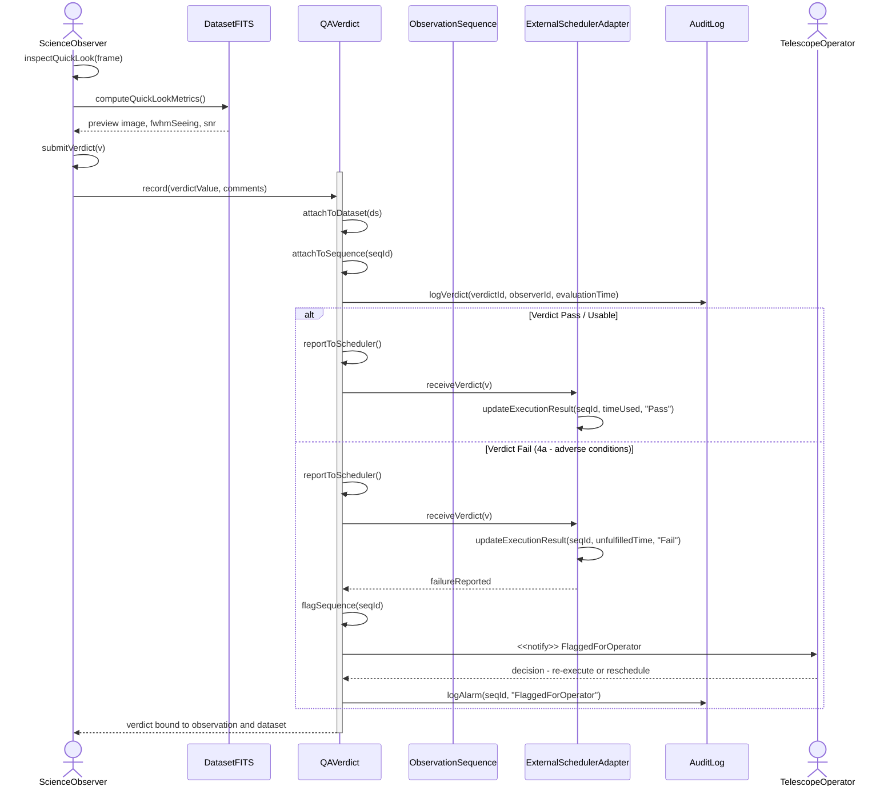

### Case 5
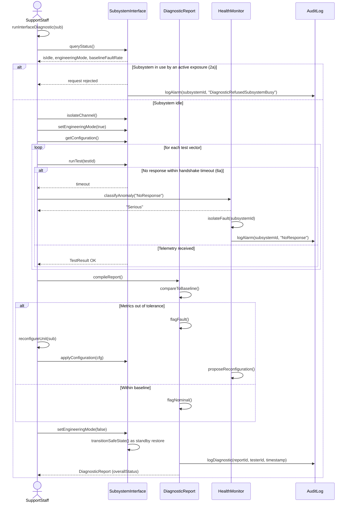