# Gemini Observatory Control System — Complete Analysis

Course ITCS382 Software Design and Modeling — Project Phase 2 — Group AZERTY

## 1. Scope and selected use cases

The Gemini Observatory Control System (OCS) has been in operation since 2000. The project improves the software modules that interface with users such as the observer, while the core control functions stay in the existing system. This analysis therefore covers only the user-facing part of the OCS: the modules that move a science plan through its lifecycle and turn it into an observing program. The telescope, instruments, data archive and existing low-level controllers remain the existing system and appear in this document only as simulated or external interfaces; the star catalogue is the external system that supplies quadrant and observable-month data.

The observation workflow followed by the analysis is: the astronomer creates a science plan, tests it with the virtual telescope in interactive observing mode, and submits it to the system; the science observer then validates the submitted plan and creates an observing program from it. Five use cases cover that workflow. Login is a precondition of every use case and is not analysed further: the account role decides which command an actor may run.

A science plan moves from `CREATED` to `TESTED`, then to `SUBMITTED`, and a submitted plan becomes `VALIDATED` or `INVALIDATED`. These are the only plan statuses used by the five use cases.

| # | Use case | Primary actor | D2 use case | Supporting or external | Result |
|:--|:--|:--|:--|:--|:--|
| 1 | Create a science plan | Astronomer | UC5 | Star Catalogue (external) | A science plan is stored with status `CREATED`. |
| 2 | Test a science plan | Astronomer | UC7, includes UC8 | Virtual telescope | The plan moves from `CREATED` to `TESTED`. |
| 3 | Submit a science plan | Astronomer | UC9 | — | The plan moves from `TESTED` to `SUBMITTED`. |
| 4 | Validate a science plan | Science Observer | UC10 | Star Catalogue (external) | The plan becomes `VALIDATED` or `INVALIDATED`; the observer and the date and time are recorded. |
| 5 | Create an observing program | Science Observer | UC11 | — | An observing program linked to the validated plan is stored. |

Four of the five use cases are carried into the design document (D4): Create a science plan, Submit a science plan, Validate a science plan and Create an observing program, numbered there UC1 to UC4 in that order. Test a science plan is represented in the prototype only by the small status-update program that changes a plan from `CREATED` to `TESTED`.

## 2. Use case descriptions

### 2.1 Create a science plan

| Field | Content |
|:--|:--|
| **Primary actor** | Astronomer |
| **Stakeholders and Interests** | <ul><li>**Astronomer:** wants to describe a planned planetary or stellar observation and the image processing its images require.</li><li>**Science Observer:** needs complete and internally consistent plans to validate later.</li><li>**Observatory operations:** needs no two plans to reserve the same telescope for overlapping dates.</li></ul> |
| **Brief Description** | The astronomer creates a science plan from the plan details, a target constellation taken from the star catalogue and the data-processing requirements; the system checks the input, the target and the schedule, allocates a plan ID and stores the plan with status `CREATED`. |
| **Precondition** | The astronomer has already logged in and the account role allows plan creation; the star catalogue is available. |
| **Trigger** | The astronomer starts the command that creates a science plan. |
| **Normal Flow** | <ol><li>The astronomer supplies the plan details and the data-processing values, and selects the target constellation.</li><li>The system builds the schedule, the target information and the data-processing settings.</li><li>The system checks the input values.</li><li>The system looks up the target in the star catalogue.</li><li>The system checks that the date range does not overlap another plan on the same telescope.</li><li>The system checks that the plan name is not already in use.</li><li>The system allocates the plan ID, creates the plan with status `CREATED` and saves it.</li><li>The system prints the plan ID, the target quadrant, the telescope and the status.</li></ol> |
| **Alternate/Exceptional Flow** | <ul><li>**3a. A required field is blank** (plan name, objective, start date or end date): the system reports "Please complete all required fields before saving the science plan."</li><li>**3b. The funding is not a positive number:** the system reports "Funding amount must be a positive numerical value."</li><li>**3c. The start date is after the end date:** the system reports "Start date cannot be after the end date."</li><li>**3d. A data-processing value required by the selected colour mode is missing:** the system reports "Please complete all required fields for the selected data processing mode."; a non-numeric or out-of-range decimal gives "Invalid input value. Please enter valid decimal numbers within the allowed range."</li><li>**4a. The target is not in the star catalogue:** the system reports "Selected target not found in the star catalogue. Please choose a valid target."</li><li>**5a. The dates overlap another plan on the same telescope:** the system reports "Selected date range conflicts with another scheduled plan for this telescope."</li><li>**6a. The plan name is already used:** the system reports "A science plan with this name already exists. Please use a different plan name."</li><li>**7a. The astronomer stops before saving:** an incomplete plan can be kept as a draft and completed later; no plan is stored with status `CREATED`.</li><li>Every rejection leaves the data store unchanged.</li></ul> |

The plan details are the plan name, the creator (filled from the account), the funding in US dollars, the objective, the start and end dates, the telescope site (Gemini North or Gemini South) and the target constellation. The data-processing values are the file type (PNG, JPEG, RAW), the file quality (Low, Fine), the colour type (colour mode or black and white mode), contrast and exposure for both modes, brightness, saturation, luminance and hue for colour mode, and highlights, shadows, whites and blacks for black and white mode.

### 2.2 Test a science plan

| Field | Content |
|:--|:--|
| **Primary actor** | Astronomer |
| **Stakeholders and Interests** | <ul><li>**Astronomer:** wants confidence that the plan works before submitting it.</li><li>**Science Observer:** needs only tested plans to reach validation.</li><li>**OCS operations:** needs the test to use the virtual telescope and interactive observing mode, not telescope time on the real system.</li></ul> |
| **Brief Description** | The astronomer tests a plan with status `CREATED` in interactive observing mode with the virtual telescope, which is the included use case Operate the interactive observing; the virtual telescope simulates the observation with the plan target and settings, and the system records the result and moves the plan from `CREATED` to `TESTED`. |
| **Precondition** | The astronomer has already logged in and owns a science plan with status `CREATED`; the virtual telescope is available. |
| **Trigger** | The astronomer selects a plan with status `CREATED` and starts the virtual-telescope test. |
| **Normal Flow** | <ol><li>The astronomer selects a plan with status `CREATED` and starts the virtual-telescope test.</li><li>The system simulates the observation with the plan target and settings.</li><li>The system records the result and moves the plan to status `TESTED`.</li><li>The system prints the plan ID and the new status.</li></ol> |
| **Alternate/Exceptional Flow** | <ul><li>**1a. The plan is not in status `CREATED`:** the system rejects the test and prints the current status; the plan is unchanged.</li><li>**2a. The simulation fails or is interrupted:** the system reports the failure and leaves the plan in status `CREATED`.</li><li>**1b. The astronomer owns no plan with status `CREATED`:** the system reports an empty list and a plan must be created first.</li></ul> |

The `CREATED` to `TESTED` transition is performed by the small status-update program required by the project: it takes a plan ID, loads the plan, marks it tested and saves it.

### 2.3 Submit a science plan

| Field | Content |
|:--|:--|
| **Primary actor** | Astronomer |
| **Stakeholders and Interests** | <ul><li>**Astronomer:** wants to see the plans he owns, with their statuses, and to submit a tested plan.</li><li>**Science Observer:** needs only tested plans to reach the submitted plans list.</li><li>**Other astronomers:** their plans must not be submitted from another account.</li></ul> |
| **Brief Description** | The astronomer lists the plans of his account, optionally filtered by status, selects a plan in status `TESTED` and confirms the submission; the system checks the ownership and the status, saves the plan with status `SUBMITTED` and prints the new status. |
| **Precondition** | The astronomer has already logged in and has at least one science plan in status `TESTED`. |
| **Trigger** | The astronomer starts the command that submits a science plan. |
| **Normal Flow** | <ol><li>The astronomer supplies the account name and, optionally, a status filter.</li><li>The system lists the plans of that astronomer with their ID, name and status.</li><li>The system asks for confirmation of the submission.</li><li>The astronomer confirms.</li><li>The system loads the plan and checks that the account owns it and that its status is `TESTED`.</li><li>The plan becomes `SUBMITTED` and is saved.</li><li>The system prints the new status.</li></ol> |
| **Alternate/Exceptional Flow** | <ul><li>**1a. The astronomer has no plans:** the system reports an empty list and a plan must be created first.</li><li>**2a. No plan matches the status filter:** the system reports an empty filtered list and no plan changes.</li><li>**4a. The astronomer does not confirm:** the submission is cancelled and the plan keeps its status.</li><li>**5a. The plan has not been tested:** the system reports "This science plan is incomplete. Please complete and test it before submission."</li><li>**5b. The plan is already `SUBMITTED` or `VALIDATED`:** the system reports "This science plan has already been submitted or executed."</li><li>**5c. The plan belongs to another account:** the system rejects the submission and leaves the plan unchanged.</li></ul> |

### 2.4 Validate a science plan

| Field | Content |
|:--|:--|
| **Primary actor** | Science Observer |
| **Stakeholders and Interests** | <ul><li>**Science Observer:** wants a submitted plan checked against the seven rules and wants the verdict, his name and the moment of validation recorded with the plan.</li><li>**Astronomer:** needs to know why a plan was rejected so that it can be corrected.</li><li>**Observatory operations:** needs only validated plans to become observing programs.</li></ul> |
| **Brief Description** | The science observer validates a submitted plan against the seven rules of the use case description; the system records the observer and the date and time and sets the plan to `VALIDATED` or to `INVALIDATED`. |
| **Precondition** | The science observer has already logged in and at least one plan is in status `SUBMITTED`. |
| **Trigger** | The science observer supplies the plan ID and the observer's name for a submitted plan. |
| **Normal Flow** | <ol><li>The science observer supplies the plan ID and the observer's name.</li><li>The system lists the plans with status `SUBMITTED`.</li><li>The system loads the plan and checks that it exists and that its status is `SUBMITTED`.</li><li>The system runs the seven validation rules.</li><li>The system records the observer and the date and time, and sets the status to `VALIDATED` or to `INVALIDATED`.</li><li>The system saves the plan.</li><li>The system prints the success message or the names of the failed rules.</li></ol> |
| **Alternate/Exceptional Flow** | <ul><li>**1a. No plan is `SUBMITTED`:** the system reports "There are currently no submitted science plans."</li><li>**3a. The plan does not exist or is not `SUBMITTED`:** the system rejects the validation and leaves the plan unchanged.</li><li>**5a. One or more rules fail:** the plan becomes `INVALIDATED`; the system prints "Validate failed." and the names of the failed rules and still records the observer and the moment of validation.</li></ul> |

#### The seven validation rules

| # | Rule |
|:--|:--|
| R1 | The plan ID is a positive integer. |
| R2 | The plan name is not blank. |
| R3 | The creator is not blank. |
| R4 | The funding is not blank. |
| R5 | The objective is not blank. |
| R6 | The assigned telescope matches the quadrant of the target constellation: NQ means Gemini North and SQ means Gemini South. |
| R7 | The start date falls in the calendar month in which the target constellation is observable. |

#### Star catalogue data used by rules R6 and R7

The star catalogue holds 88 constellations: 36 northern constellations (NQ1, NQ2, NQ3 and NQ4 with 8, 10, 8 and 10 constellations) and 52 southern constellations (SQ1, SQ2, SQ3 and SQ4 with 14, 11, 14 and 13). Each constellation has exactly one quadrant and exactly one calendar month in which it is observable. The complete quadrant and month tables are catalogue reference data and are not repeated here; four examples are enough to show the format.

| Constellation | Quadrant | Telescope | Observable month |
|:--|:--|:--|:--|
| Orion | NQ1 | Gemini North | January |
| Gemini | NQ2 | Gemini North | February |
| Crux | SQ3 | Gemini South | May |
| Sculptor | SQ1 | Gemini South | November |

The system reads these values through the external Star Catalogue interface when a plan selects a target and when rules R6 and R7 are checked.

### 2.5 Create an observing program

| Field | Content |
|:--|:--|
| **Primary actor** | Science Observer |
| **Stakeholders and Interests** | <ul><li>**Science Observer:** wants to transform a validated science plan into an observing program and be recorded as its creator.</li><li>**Astronomer:** wants the observing program to carry the settings that were validated for the plan.</li><li>**Observatory operations:** needs the observing program to be linked to its science plan and to carry values inside the supported ranges.</li></ul> |
| **Brief Description** | The science observer converts a validated science plan into an observing program by supplying the optics, mechanism, calibration and telescope-position values; the system checks the values against their ranges, allocates the program ID, stores the program linked to the plan and records the observer as its creator. |
| **Precondition** | The science observer has already logged in and at least one science plan is in status `VALIDATED`. |
| **Trigger** | The science observer supplies the plan ID, the observer's name, the observing-program values and the telescope position pairs. |
| **Normal Flow** | <ol><li>The science observer supplies the plan ID, the observer's name, the observing-program values and the position pairs.</li><li>The system lists the plans with status `VALIDATED`.</li><li>The system loads the plan and checks that it exists and that its status is `VALIDATED`.</li><li>The system checks the optics values against their ranges.</li><li>The system checks the mechanism values against their ranges.</li><li>The system allocates the program ID, creates the observing program linked to the science plan and saves it.</li><li>The system prints the program ID, the derived location, the plan ID and the status.</li></ol> |
| **Alternate/Exceptional Flow** | <ul><li>**1a. No plan is `VALIDATED`:** the system reports "No validated science plans found."</li><li>**3a. The plan does not exist or is not `VALIDATED`:** the system rejects the creation and stores nothing.</li><li>**4a. An optics value is outside its range:** the system rejects the program, prints the permitted range of the field and stores nothing.</li><li>**5a. A mechanism value is not permitted:** the fold-mirror degree must lie in [30, 45] and the module content in 1 to 4; otherwise the system rejects the program and stores nothing.</li><li>**6a. A required value is missing:** the system asks the observer to supply it before the program is created.</li></ul> |

#### Observing-program values and their ranges

| Value | Detail and permitted values |
|:--|:--|
| Optics primary | `GNZ`, the Gemini North Zemax model, or `GSZ`, the Gemini South Zemax model. |
| F-stop | `GNZ`: 1.8 to 8.1; `GSZ`: 2.9 to 18. |
| Optics secondary RMS | Gemini North: 5 to 17 nm; Gemini South: 5 to 13 nm. |
| Science fold mirror degree | 30 to 45 inclusive. |
| Science fold mirror type | Reflective converging beam or Cassegrain focus. |
| Module content | 1: acquisition camera and high-resolution wavefront sensor; 2: science fold; 3: second peripheral wavefront sensor; 4: first peripheral wavefront sensor, closest to the sky. |
| Calibration unit | Argon, Xenon, ThAr or CuAr. |
| Light type | Mauna Kea sky emission or Cerro Pachón sky emission. |
| Telescope position pair | One or more pairs; each pair holds a direction and a degree. |

The Gemini location of the observing program is derived from the telescope of the science plan, Gemini North or Gemini South, which the validation has already checked against the target quadrant.

## 3. Activity Diagram

Each diagram below is the activity model of one of the five use cases. The words in the diamonds are the decisions taken by the system.

### 3.1 Create a science plan

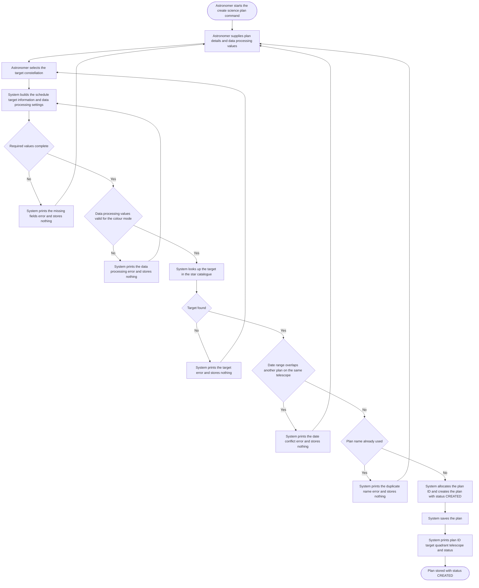

### 3.2 Test a science plan

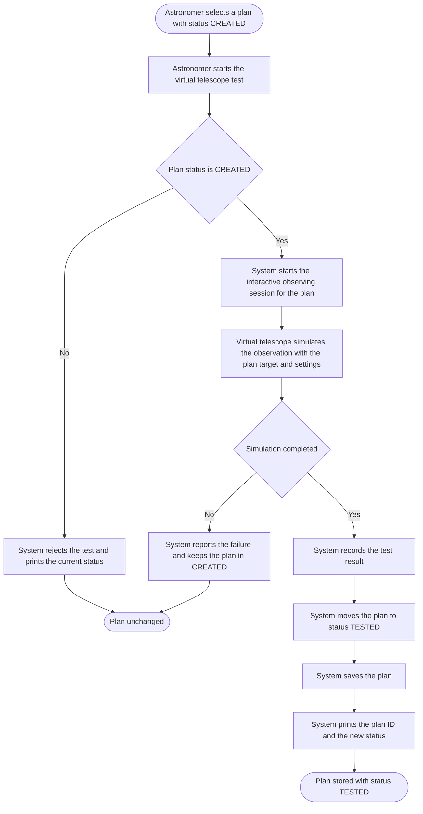

The interactive observing session is the included use case Operate the interactive observing, shown as the virtual telescope.

### 3.3 Submit a science plan

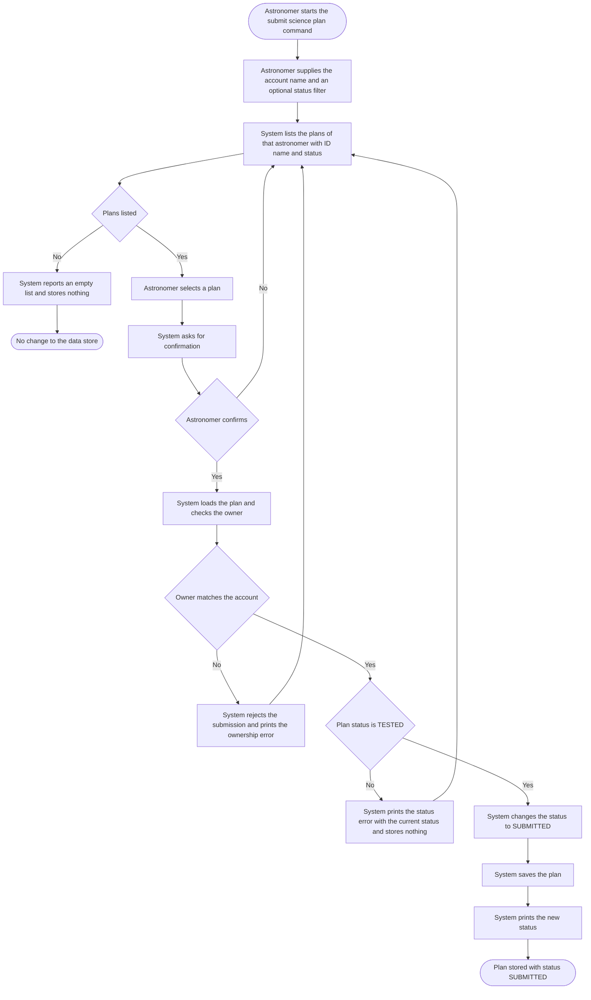

### 3.4 Validate a science plan

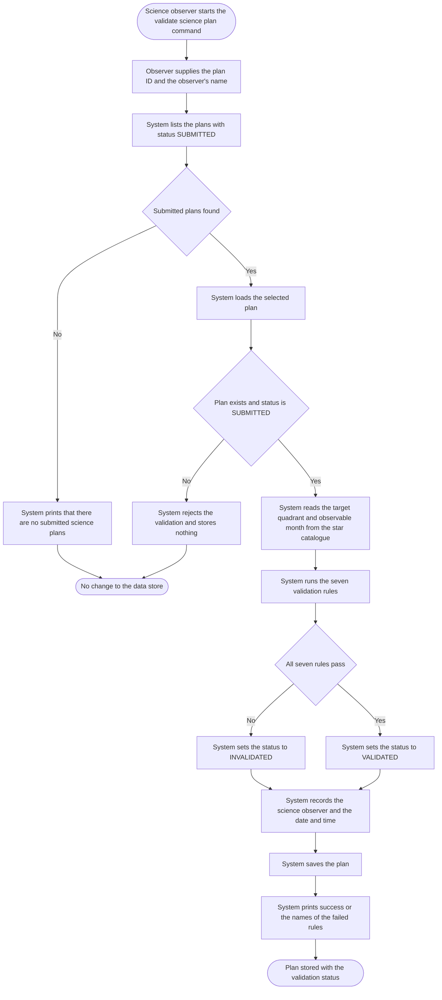

### 3.5 Create an observing program

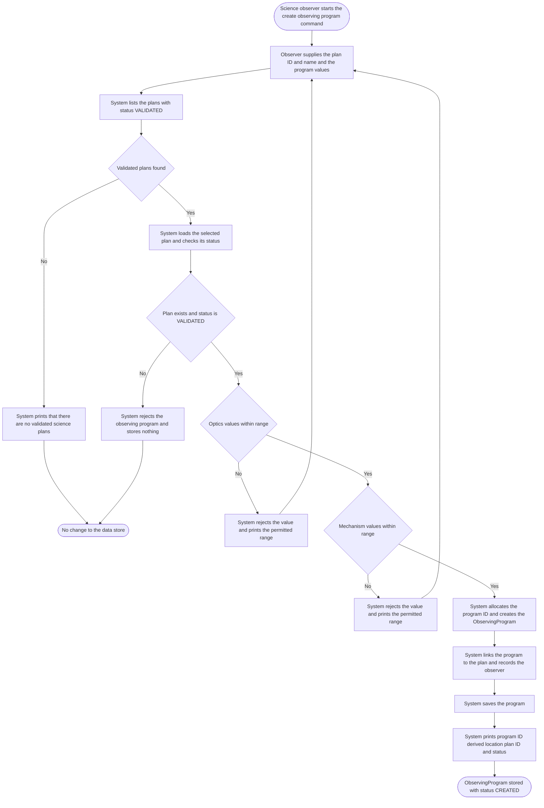

## 4. Class Diagram

The analysis-level class diagram contains 12 classes for the five use cases: the entity classes named in the use case narratives, the two status enumerations and the external star catalogue. The two status enumerations hold only the values used by these use cases; the narrative also defines `RUNNING`, `COMPLETE` and `CANCELLED`, which belong to execution use cases outside this analysis.

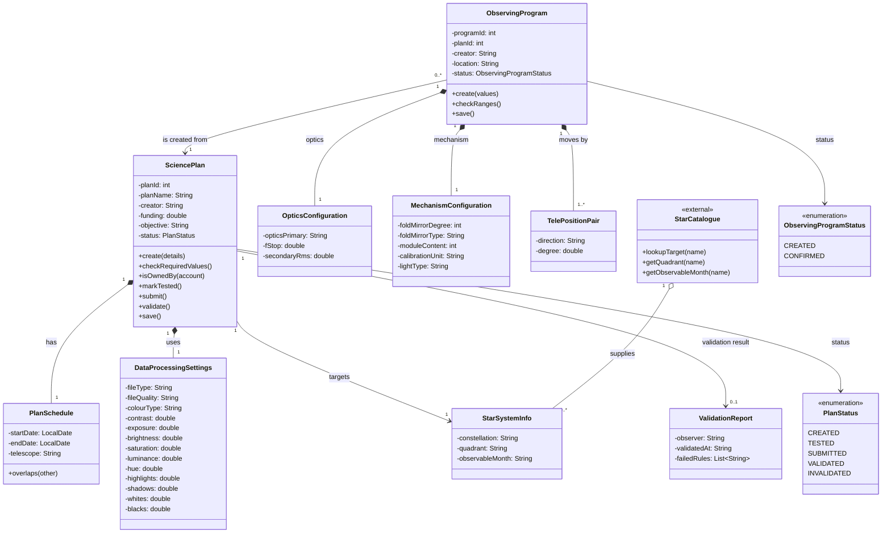

A science plan owns one schedule, one target description and one set of data-processing settings; the validation result is optional until the plan has been validated. An observing program is created from exactly one validated plan and owns its optics, mechanism and position data. The external star catalogue supplies the target description that rules R6 and R7 use.

## 5. Sequence Diagram

Each diagram starts at the actor, enters the system object `:OCS` and then calls the domain objects of the class diagram; the message order follows the normal flow of the use case. Every diagram has between 8 and 10 messages.

### 5.1 Create a science plan

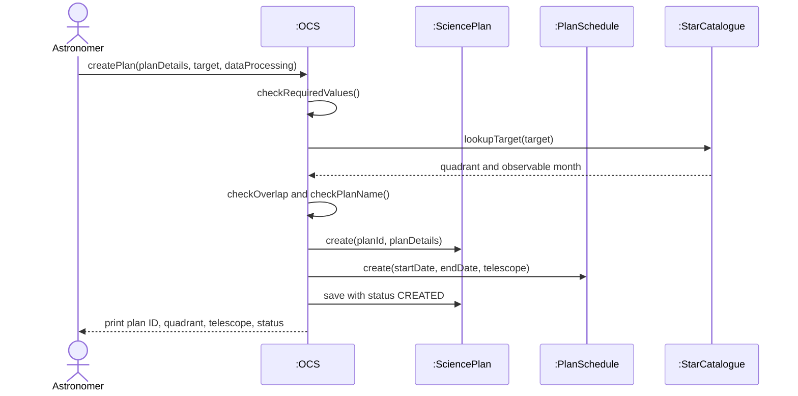

### 5.2 Test a science plan

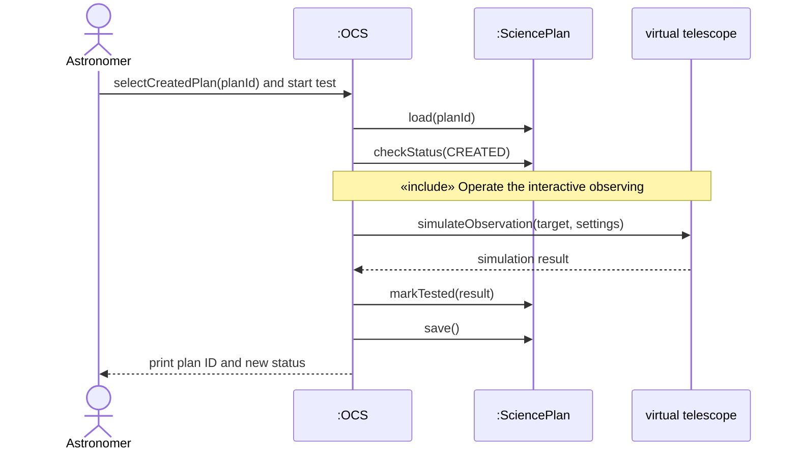

The virtual telescope is the included use case Operate the interactive observing; it is a simulated interface, not a class of the class diagram.

### 5.3 Submit a science plan

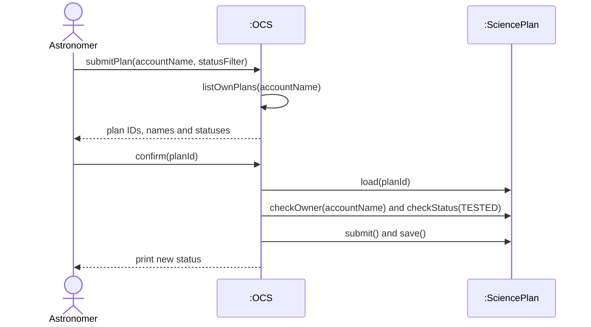

### 5.4 Validate a science plan

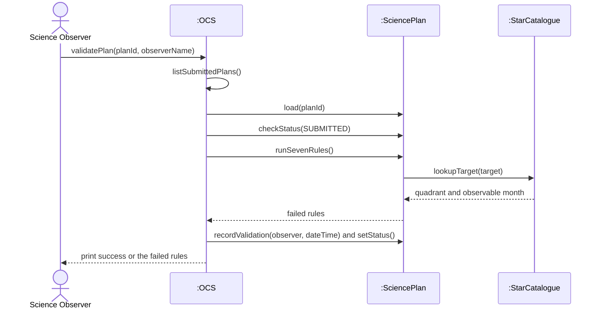

### 5.5 Create an observing program

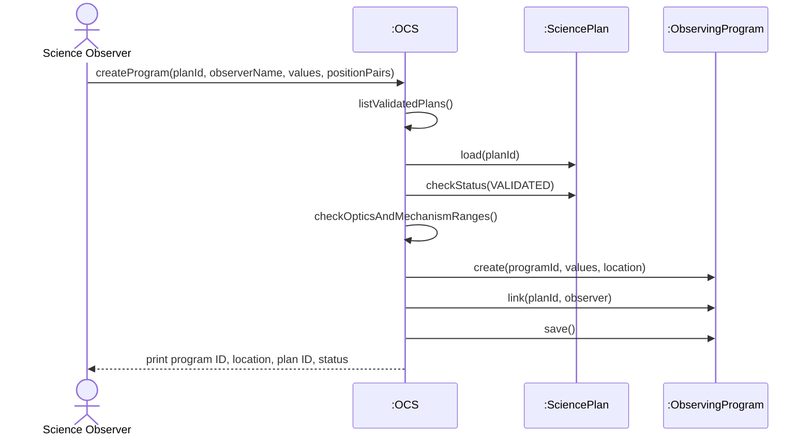
