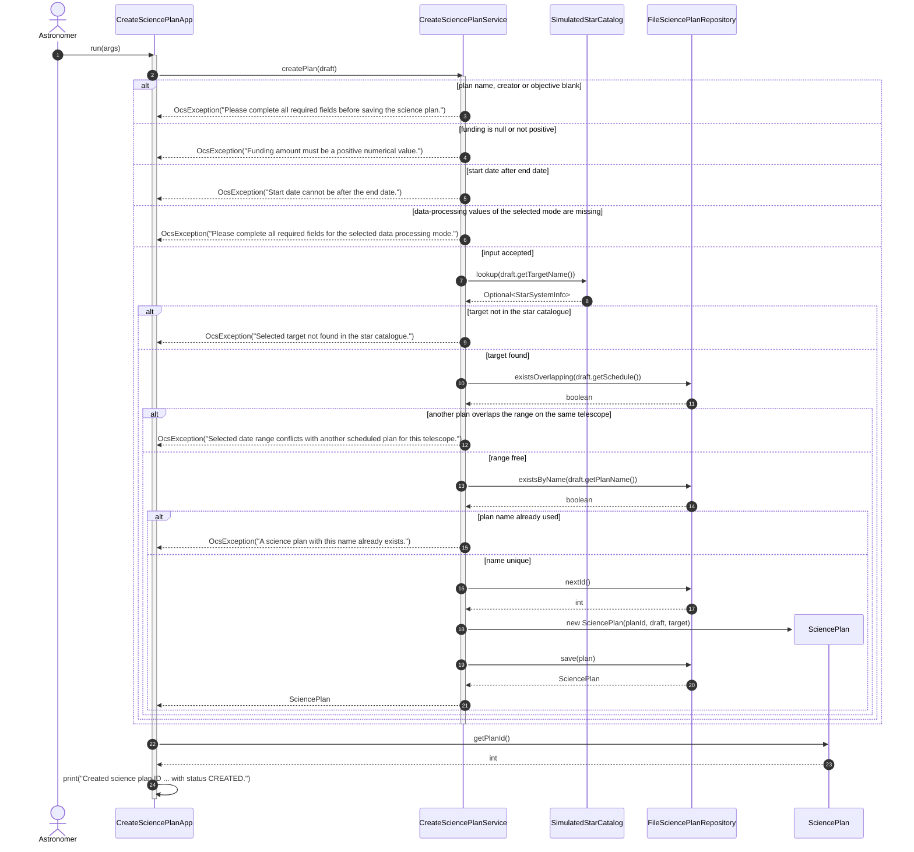
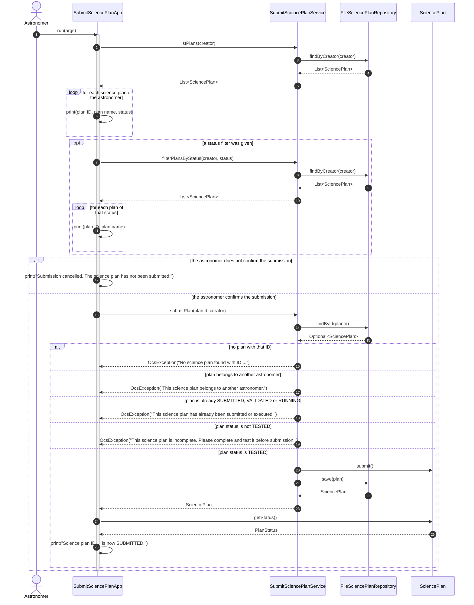
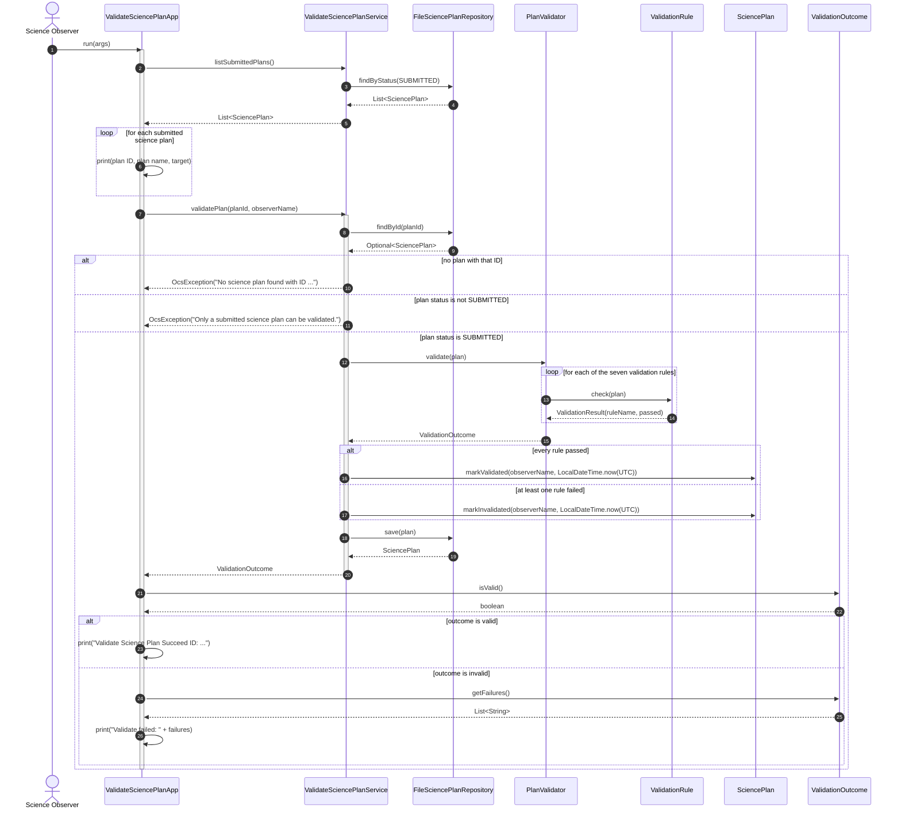
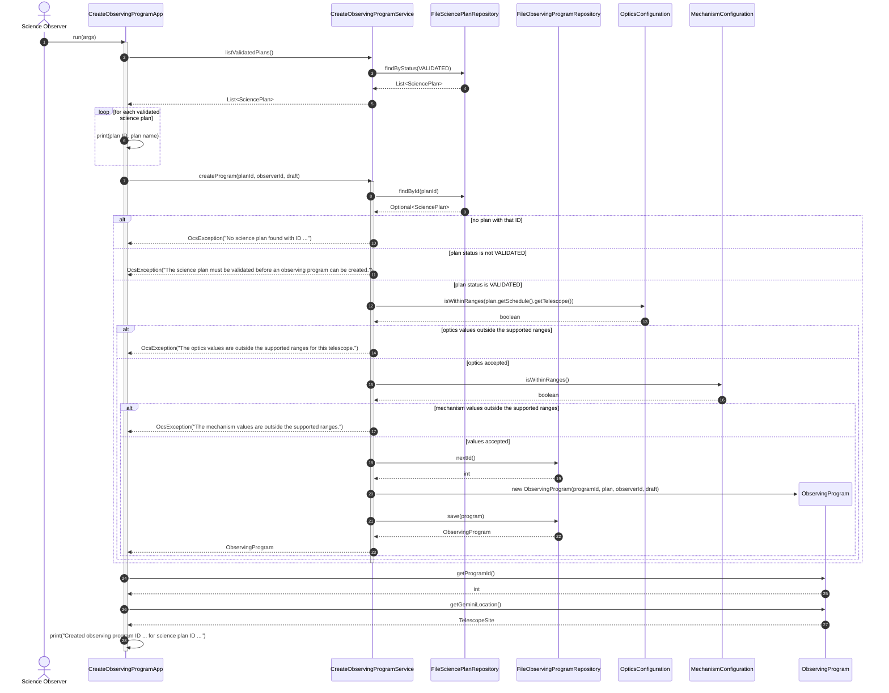

# AZERTY — D4: Design Model of the Gemini OCS Prototype

ITCS382 Software Design and Modeling · Project Phase 2 · Group **AZERTY**
Prototype: Observatory Control System (OCS) of the Gemini Observatory, Java 17, Maven, command line.

This file contains the design model (Part 1 of D4): the package diagram, one design-level class
diagram, four design-level sequence diagrams and four revised use case descriptions. The design
rationale, the run instructions, the traceability table and the quality results are in
`AZERTY_D4_Report.md`. The implementation is in the `ocs` folder.

---

## 1. The four selected use cases

| # | Use case | Primary actor | Artifact handed to the next use case |
|---|----------|---------------|--------------------------------------|
| UC1 | **Create Science Plan** | Astronomer | a `SciencePlan` in status `CREATED` |
| UC2 | **Submit Science Plan** | Astronomer | the same `SciencePlan` in status `SUBMITTED` |
| UC3 | **Validate Science Plan** | Science Observer | the same `SciencePlan` in status `VALIDATED` or `INVALIDATED` |
| UC4 | **Create Observing Program** | Science Observer | a new `ObservingProgram` for the validated `SciencePlan` |

An auxiliary command, `mark-tested`, implements the small program that the *Submit Science Plan*
description requires in order to move a plan from `CREATED` to `TESTED`. It is part of UC2's
preconditions and is therefore designed here as well (class `MarkPlanTestedService` and
`MarkPlanTestedApp`). It is not a fifth use case and earns no separate marks.

**Why these four.**

1. **They form one connected flow, as the selection rule requires.** Each use case operates on the
   object that the previous one produced: UC1 creates the science plan, UC2 changes its status so
   that it becomes eligible for validation, UC3 validates that same plan, and UC4 reads the validated
   plan and produces the observing program. The four share the classes `SciencePlan`, `PlanSchedule`,
   `StarSystemInfo`, `DataProcessingSettings` and the two repositories; there is no isolated or
   decorative use case among them.
2. **UC4 involves both major classes of the Gemini system.** It reads a `SciencePlan` and creates an
   `ObservingProgram`, so the pair SciencePlan–ObservingProgram is present in one use case, as the
   selection rule demands.
3. **The narrative document specifies these four completely.** It gives the fields of a science plan,
   the eight statuses, the seven validation criteria, the 88-constellation quadrant and month tables,
   and every range of an observing program. The prototype's data and rules can therefore follow the
   document exactly instead of inventing domain rules.
4. **Login and Execute Science Plan are excluded for the reasons the course gives.** `Login` does not
   count towards the four. `Execute Science Plan` appears in the workflow slides but the narrative
   document defines no data and no rules for it; implementing it would mean inventing the very rules
   that the description says must follow the provided documents.
5. **Phase 1 coverage.** The Phase 1 analysis (D3) modelled the OCS as a hierarchy of
   `ScienceProgram` → `ObservationSequence` → `ObservationStep`. It contains no `SciencePlan` and no
   `ObservingProgram` class, so none of its five use cases can satisfy requirement 2 above. The
   selection rule covers this case explicitly: a team whose Phase 1 analysis covers fewer than four
   suitable use cases "analyses the remaining ones as part of this deliverable". The four use cases
   above are therefore analysed here, in the D4 design, and their descriptions below are written in
   the same Markdown table format that Phase 1 used.

### Team decisions that the source documents leave open

The following points are not defined by the provided documents. They are decisions of this team,
recorded here so that the model and the code can be read unambiguously.

| # | Decision | Reason |
|---|----------|--------|
| D1 | The `PlanStatus` enum declares all eight statuses of the narrative, but only the four transitions used by UC1–UC4 are implemented (`CREATED`→`TESTED`→`SUBMITTED`→`VALIDATED`/`INVALIDATED`). | `RUNNING`, `COMPLETE` and `CANCELLED` belong to execution use cases that are outside the four selected use cases. Implementing unused transitions would be code beyond the design. |
| D2 | `ObservingProgramStatus` has the two values `CREATED` and `CONFIRMED`. | The narrative says the system "updates the validation status of the observing program" but never names its values; validation of an observing program is not one of the selected use cases, so a minimal status is modelled. |
| D3 | `TelePositionPair.direction` is an enumeration of four compass directions (`NORTH`, `SOUTH`, `EAST`, `WEST`); `degree` is a `double` with no range check. | The narrative says each pair "holds a direction and a degree" but gives no vocabulary and no range. The fold-mirror range [30, 45] belongs to a different field and is not reused. |
| D4 | `SciencePlan.validatedAt` is recorded in UTC. | D1 requirement 36 requires UTC timestamps for recorded events. The narrative only says "the date and time of the validation". |
| D5 | Login is out of scope. The actor identity is passed on the command line (`--creator`, `--observer`). | `Login` does not count towards the four use cases and the precondition of every use case is that the actor "has already logged in". |
| D6 | The "save the plan as a draft and complete it later" branch of the Create a Science Plan description is not implemented. | Resuming an incomplete plan is a separate edit use case, which is outside the four selected use cases; the description has been revised accordingly in section 5. |

### Notation conventions used by the diagrams

* `ocs.domain` is an ordinary Java package, not a reverse-domain name: the group does not own a
  domain, and the repository root already identifies the project.
* In the class diagram, `+` is public, `-` is private and `#` is protected; `$` after a member marks
  it `static` (the UML underline); `/` before an attribute name marks it computed rather than stored;
  `~T~` is Mermaid's rendering of a generic parameter, so `List~TelePositionPair~` is
  `List<TelePositionPair>`.
* Multiplicities and role names appear on the associations; an association arrow points at the class
  that is referenced, so the tail is the class that holds the reference.
* Sequence diagrams start at the actor; the command-line class that receives the input is the second
  lifeline. `print(...)` messages are calls of the protected operation that `AbstractCliApp` gives to
  all five command classes.

---

## 2. Package diagram

Each box below is a Java package and contains exactly the classes that live in it. Every arrow is a
permitted dependency: the implementation contains no other dependency between these packages and no
cycle.

```mermaid
flowchart TD
    subgraph cli["ocs.cli — command line and composition root"]
        direction TB
        Bootstrap["Bootstrap<br/>«composition root»"]
        AbstractCliApp
        ArgumentValues
        CreateSciencePlanApp
        MarkPlanTestedApp
        SubmitSciencePlanApp
        ValidateSciencePlanApp
        CreateObservingProgramApp
    end

    subgraph service["ocs.service — use-case services"]
        direction TB
        CreateSciencePlanService
        MarkPlanTestedService
        SubmitSciencePlanService
        ValidateSciencePlanService
        CreateObservingProgramService
    end

    subgraph validation["ocs.validation — validation rules (Strategy)"]
        direction TB
        ValidationRule["ValidationRule<br/>«interface / Strategy»"]
        PlanValidator["PlanValidator<br/>«Context»"]
        PlanIdPositiveRule
        PlanNameNotBlankRule
        CreatorNotBlankRule
        FundingNotBlankRule
        ObjectiveNotBlankRule
        QuadrantTelescopeConsistencyRule
        ObservationMonthRule
    end

    subgraph catalog["ocs.catalog — simulated external system"]
        direction TB
        SimulatedStarCatalog["SimulatedStarCatalog<br/>«simulated star catalogue»"]
    end

    subgraph persistence["ocs.persistence — data store access"]
        direction TB
        PropertyFileStore["PropertyFileStore<br/>«accesses the data store»"]
        FileSciencePlanRepository["FileSciencePlanRepository<br/>«accesses the data store»"]
        FileObservingProgramRepository["FileObservingProgramRepository<br/>«accesses the data store»"]
    end

    subgraph domain["ocs.domain — entities, value objects, ports"]
        direction TB
        SciencePlan
        SciencePlanDraft
        ObservingProgram
        ObservingProgramDraft
        PlanSchedule
        StarSystemInfo
        DataProcessingSettings
        ColorAdjustments
        ToneAdjustments
        OpticsConfiguration
        MechanismConfiguration
        TelePositionPair
        OcsException
        StarCatalog["StarCatalog<br/>«interface • hides the star catalogue»"]
        SciencePlanRepository["SciencePlanRepository<br/>«interface • data store port»"]
        ObservingProgramRepository["ObservingProgramRepository<br/>«interface • data store port»"]
    end

    DataStore[("data/ directory<br/>science_plans/ and observing_programs/<br/>created on first run")]

    cli --> service
    cli --> domain
    cli --> catalog
    cli --> persistence
    cli --> validation
    service --> domain
    service --> validation
    validation --> domain
    catalog --> domain
    persistence --> domain
    persistence --> DataStore
```



The external system of these four use cases is the **star catalogue**, which belongs to the
observatory's existing user tools and is not part of the OCS: `ocs.domain.StarCatalog` hides it and
`ocs.catalog.SimulatedStarCatalog` is its simulated version. The data store is accessed only by
`ocs.persistence`, whose classes implement the two repository interfaces declared in
`ocs.domain`. `ocs.service` and `ocs.validation` never see a file, a `Properties` object or the
simulated catalogue class; only `Bootstrap` knows both sides of every port.

---

## 3. Design-level class diagram

Every class that participates in UC1–UC4 appears below, together with its fields, constructors and
operations, the associations and their multiplicities, and the classes that play a role in the
Strategy pattern.

`````mermaid
classDiagram
    class PlanStatus {
        <<enumeration>>
        CREATED
        TESTED
        SUBMITTED
        VALIDATED
        INVALIDATED
        RUNNING
        COMPLETE
        CANCELLED
    }
    class TelescopeSite {
        <<enumeration>>
        GEMINI_NORTH
        GEMINI_SOUTH
    }
    class Quadrant {
        <<enumeration>>
        NQ1
        NQ2
        NQ3
        NQ4
        SQ1
        SQ2
        SQ3
        SQ4
        +isNorth(): boolean
    }
    class Direction {
        <<enumeration>>
        NORTH
        SOUTH
        EAST
        WEST
    }
    class FileType {
        <<enumeration>>
        PNG
        JPEG
        RAW
    }
    class FileQuality {
        <<enumeration>>
        LOW
        FINE
    }
    class ColorType {
        <<enumeration>>
        COLOR
        BLACK_AND_WHITE
    }
    class OpticsPrimary {
        <<enumeration>>
        GNZ
        GSZ
    }
    class FoldMirrorType {
        <<enumeration>>
        REFLECTIVE_CONVERGING_BEAM
        CASSEGRAIN_FOCUS
    }
    class CalibrationUnit {
        <<enumeration>>
        ARGON
        XENON
        TH_AR
        CU_AR
    }
    class LightType {
        <<enumeration>>
        MAUNA_KEA_SKY_EMISSION
        CERRO_PACHON_SKY_EMISSION
    }
    class ObservingProgramStatus {
        <<enumeration>>
        CREATED
        CONFIRMED
    }
    class PlanSchedule {
        -startDate: LocalDate
        -endDate: LocalDate
        -telescope: TelescopeSite
        +PlanSchedule(startDate: LocalDate, endDate: LocalDate, telescope: TelescopeSite)
        +getStartDate(): LocalDate
        +getEndDate(): LocalDate
        +getTelescope(): TelescopeSite
        +isOrdered(): boolean
        +overlaps(other: PlanSchedule): boolean
    }
    class StarSystemInfo {
        -constellation: String
        -quadrant: Quadrant
        -availableMonth: Month
        +StarSystemInfo(constellation: String, quadrant: Quadrant, availableMonth: Month)
        +getConstellation(): String
        +getQuadrant(): Quadrant
        +getAvailableMonth(): Month
        +isObservableIn(month: Month): boolean
    }
    class ColorAdjustments {
        -brightness: double
        -saturation: double
        -luminance: double
        -hue: double
        +ColorAdjustments(brightness: double, saturation: double, luminance: double, hue: double)
        +getBrightness(): double
        +getSaturation(): double
        +getLuminance(): double
        +getHue(): double
    }
    class ToneAdjustments {
        -highlights: double
        -shadows: double
        -whites: double
        -blacks: double
        +ToneAdjustments(highlights: double, shadows: double, whites: double, blacks: double)
        +getHighlights(): double
        +getShadows(): double
        +getWhites(): double
        +getBlacks(): double
    }
    class DataProcessingSettings {
        -fileType: FileType
        -fileQuality: FileQuality
        -colorType: ColorType
        -contrast: double
        -exposure: double
        -colorAdjustments: ColorAdjustments
        -toneAdjustments: ToneAdjustments
        +DataProcessingSettings(fileType: FileType, fileQuality: FileQuality, colorType: ColorType, contrast: double, exposure: double, colorAdjustments: ColorAdjustments, toneAdjustments: ToneAdjustments)
        +getFileType(): FileType
        +getFileQuality(): FileQuality
        +getColorType(): ColorType
        +getContrast(): double
        +getExposure(): double
        +getColorAdjustments(): ColorAdjustments
        +getToneAdjustments(): ToneAdjustments
        +isCompleteForMode(): boolean
    }
    class OpticsConfiguration {
        -opticsPrimary: OpticsPrimary
        -fStop: double
        -opticsSecondaryRmsNm: double
        +OpticsConfiguration(opticsPrimary: OpticsPrimary, fStop: double, opticsSecondaryRmsNm: double)
        +getOpticsPrimary(): OpticsPrimary
        +getFStop(): double
        +getOpticsSecondaryRmsNm(): double
        +isWithinRanges(site: TelescopeSite): boolean
    }
    class MechanismConfiguration {
        -foldMirrorDegree: double
        -foldMirrorType: FoldMirrorType
        -moduleContent: int
        -calibrationUnit: CalibrationUnit
        -lightType: LightType
        +MechanismConfiguration(foldMirrorDegree: double, foldMirrorType: FoldMirrorType, moduleContent: int, calibrationUnit: CalibrationUnit, lightType: LightType)
        +getFoldMirrorDegree(): double
        +getFoldMirrorType(): FoldMirrorType
        +getModuleContent(): int
        +getCalibrationUnit(): CalibrationUnit
        +getLightType(): LightType
        +isWithinRanges(): boolean
    }
    class TelePositionPair {
        -direction: Direction
        -degree: double
        +TelePositionPair(direction: Direction, degree: double)
        +getDirection(): Direction
        +getDegree(): double
    }
    class SciencePlanDraft {
        -planName: String
        -creator: String
        -funding: BigDecimal
        -objective: String
        -schedule: PlanSchedule
        -targetName: String
        -dataProcessingSettings: DataProcessingSettings
        +SciencePlanDraft(planName: String, creator: String, funding: BigDecimal, objective: String, schedule: PlanSchedule, targetName: String, dataProcessingSettings: DataProcessingSettings)
        +getPlanName(): String
        +getCreator(): String
        +getFunding(): BigDecimal
        +getObjective(): String
        +getSchedule(): PlanSchedule
        +getTargetName(): String
        +getDataProcessingSettings(): DataProcessingSettings
    }
    class ObservingProgramDraft {
        -optics: OpticsConfiguration
        -mechanism: MechanismConfiguration
        -telePositionPairs: List~TelePositionPair~
        +ObservingProgramDraft(optics: OpticsConfiguration, mechanism: MechanismConfiguration, telePositionPairs: List~TelePositionPair~)
        +getOptics(): OpticsConfiguration
        +getMechanism(): MechanismConfiguration
        +getTelePositionPairs(): List~TelePositionPair~
    }
    class SciencePlan {
        -planId: int
        -planName: String
        -creator: String
        -funding: BigDecimal
        -objective: String
        -schedule: PlanSchedule
        -target: StarSystemInfo
        -dataProcessingSettings: DataProcessingSettings
        -status: PlanStatus
        -validatedBy: String
        -validatedAt: LocalDateTime
        +SciencePlan(planId: int, draft: SciencePlanDraft, target: StarSystemInfo)
        +getPlanId(): int
        +getPlanName(): String
        +getCreator(): String
        +getFunding(): BigDecimal
        +getObjective(): String
        +getSchedule(): PlanSchedule
        +getTarget(): StarSystemInfo
        +getDataProcessingSettings(): DataProcessingSettings
        +getStatus(): PlanStatus
        +getValidatedBy(): String
        +getValidatedAt(): LocalDateTime
        +markTested()
        +submit()
        +markValidated(observerName: String, validatedAtUtc: LocalDateTime)
        +markInvalidated(observerName: String, validatedAtUtc: LocalDateTime)
        +restoreState(status: PlanStatus, validatedBy: String, validatedAt: LocalDateTime)
    }
    class ObservingProgram {
        -programId: int
        -sciencePlan: SciencePlan
        -createdBy: String
        -optics: OpticsConfiguration
        -mechanism: MechanismConfiguration
        -telePositionPairs: List~TelePositionPair~
        -status: ObservingProgramStatus
        +/geminiLocation: TelescopeSite
        +ObservingProgram(programId: int, sciencePlan: SciencePlan, createdBy: String, draft: ObservingProgramDraft)
        +getProgramId(): int
        +getSciencePlan(): SciencePlan
        +getCreatedBy(): String
        +getOptics(): OpticsConfiguration
        +getMechanism(): MechanismConfiguration
        +getTelePositionPairs(): List~TelePositionPair~
        +getStatus(): ObservingProgramStatus
        +getGeminiLocation(): TelescopeSite
        +restoreStatus(restoredStatus: ObservingProgramStatus)
    }
    class OcsException {
        -serialVersionUID: long$
        +OcsException(message: String)
    }
    class StarCatalog {
        <<interface>>
        +lookup(constellation: String): Optional~StarSystemInfo~
    }
    class SciencePlanRepository {
        <<interface>>
        +nextId(): int
        +save(plan: SciencePlan): SciencePlan
        +findById(planId: int): Optional~SciencePlan~
        +findByCreator(creator: String): List~SciencePlan~
        +findByStatus(status: PlanStatus): List~SciencePlan~
        +existsByName(planName: String): boolean
        +existsOverlapping(schedule: PlanSchedule): boolean
    }
    class ObservingProgramRepository {
        <<interface>>
        +nextId(): int
        +save(program: ObservingProgram): ObservingProgram
        +findById(programId: int): Optional~ObservingProgram~
    }
    class ValidationRule {
        <<interface>>
        +name(): String
        +check(plan: SciencePlan): ValidationResult
    }
    class ValidationResult {
        -ruleName: String
        -passed: boolean
        +ValidationResult(ruleName: String, passed: boolean)
        +getRuleName(): String
        +isPassed(): boolean
    }
    class ValidationOutcome {
        -results: List~ValidationResult~
        +ValidationOutcome(results: List~ValidationResult~)
        +isValid(): boolean
        +getFailures(): List~String~
    }
    class PlanValidator {
        -rules: List~ValidationRule~
        +PlanValidator(rules: List~ValidationRule~)
        +validate(plan: SciencePlan): ValidationOutcome
    }
    class PlanIdPositiveRule {
        +name(): String
        +check(plan: SciencePlan): ValidationResult
    }
    class PlanNameNotBlankRule {
        +name(): String
        +check(plan: SciencePlan): ValidationResult
    }
    class CreatorNotBlankRule {
        +name(): String
        +check(plan: SciencePlan): ValidationResult
    }
    class FundingNotBlankRule {
        +name(): String
        +check(plan: SciencePlan): ValidationResult
    }
    class ObjectiveNotBlankRule {
        +name(): String
        +check(plan: SciencePlan): ValidationResult
    }
    class QuadrantTelescopeConsistencyRule {
        +name(): String
        +check(plan: SciencePlan): ValidationResult
    }
    class ObservationMonthRule {
        +name(): String
        +check(plan: SciencePlan): ValidationResult
    }
    class SimulatedStarCatalog {
        -RESOURCE: String$
        -systems: Map~String, StarSystemInfo~
        +SimulatedStarCatalog()
        +lookup(constellation: String): Optional~StarSystemInfo~
        +loadSystems(): Map~String, StarSystemInfo~
    }
    class PropertyFileStore {
        -DATA_DIR: Path$
        -directory: Path
        +PropertyFileStore(directoryName: String)
        +save(key: String, values: Properties)
        +load(key: String): Properties
        +keys(): List~String~
        +contains(key: String): boolean
    }
    class FileSciencePlanRepository {
        -store: PropertyFileStore
        +FileSciencePlanRepository()
        +nextId(): int
        +save(plan: SciencePlan): SciencePlan
        +findById(planId: int): Optional~SciencePlan~
        +findByCreator(creator: String): List~SciencePlan~
        +findByStatus(status: PlanStatus): List~SciencePlan~
        +existsByName(planName: String): boolean
        +existsOverlapping(schedule: PlanSchedule): boolean
        +loadAll(): List~SciencePlan~
        +toPlan(values: Properties): SciencePlan
        +toProperties(plan: SciencePlan): Properties
    }
    class FileObservingProgramRepository {
        -store: PropertyFileStore
        -planRepository: SciencePlanRepository
        +FileObservingProgramRepository(planRepository: SciencePlanRepository)
        +nextId(): int
        +save(program: ObservingProgram): ObservingProgram
        +findById(programId: int): Optional~ObservingProgram~
        +loadAll(): List~ObservingProgram~
        +toProgram(values: Properties): ObservingProgram
        +toProperties(program: ObservingProgram): Properties
    }
    class CreateSciencePlanService {
        -starCatalog: StarCatalog
        -planRepository: SciencePlanRepository
        +CreateSciencePlanService(starCatalog: StarCatalog, planRepository: SciencePlanRepository)
        +createPlan(draft: SciencePlanDraft): SciencePlan
        -isBlank(value: String): boolean$
    }
    class MarkPlanTestedService {
        -planRepository: SciencePlanRepository
        +MarkPlanTestedService(planRepository: SciencePlanRepository)
        +markPlanTested(planId: int): SciencePlan
    }
    class SubmitSciencePlanService {
        -planRepository: SciencePlanRepository
        +SubmitSciencePlanService(planRepository: SciencePlanRepository)
        +listPlans(creator: String): List~SciencePlan~
        +filterPlansByStatus(creator: String, status: PlanStatus): List~SciencePlan~
        +submitPlan(planId: int, creator: String): SciencePlan
    }
    class ValidateSciencePlanService {
        -planRepository: SciencePlanRepository
        -planValidator: PlanValidator
        +ValidateSciencePlanService(planRepository: SciencePlanRepository, planValidator: PlanValidator)
        +listSubmittedPlans(): List~SciencePlan~
        +validatePlan(planId: int, observerName: String): ValidationOutcome
    }
    class CreateObservingProgramService {
        -planRepository: SciencePlanRepository
        -programRepository: ObservingProgramRepository
        +CreateObservingProgramService(planRepository: SciencePlanRepository, programRepository: ObservingProgramRepository)
        +listValidatedPlans(): List~SciencePlan~
        +createProgram(planId: int, observerId: String, draft: ObservingProgramDraft): ObservingProgram
    }
    class AbstractCliApp {
        <<abstract>>
        +run(args: String[])
        #execute(values: ArgumentValues)*
        #print(line: String)
    }
    class ArgumentValues {
        -values: Map~String, String~
        +ArgumentValues(args: String[])
        +getString(key: String): String
        +getInt(key: String): int
        +getDouble(key: String): double
        +getDate(key: String): LocalDate
        +getAll(key: String): List~String~
        +has(key: String): boolean
    }
    class CreateSciencePlanApp {
        -service: CreateSciencePlanService
        +CreateSciencePlanApp(service: CreateSciencePlanService)
        #execute(values: ArgumentValues)
    }
    class MarkPlanTestedApp {
        -service: MarkPlanTestedService
        +MarkPlanTestedApp(service: MarkPlanTestedService)
        #execute(values: ArgumentValues)
    }
    class SubmitSciencePlanApp {
        -service: SubmitSciencePlanService
        +SubmitSciencePlanApp(service: SubmitSciencePlanService)
        #execute(values: ArgumentValues)
    }
    class ValidateSciencePlanApp {
        -service: ValidateSciencePlanService
        +ValidateSciencePlanApp(service: ValidateSciencePlanService)
        #execute(values: ArgumentValues)
    }
    class CreateObservingProgramApp {
        -service: CreateObservingProgramService
        +CreateObservingProgramApp(service: CreateObservingProgramService)
        #execute(values: ArgumentValues)
    }
    class Bootstrap {
        -USAGE: String$
        +main(args: String[])$
        -printUsage()$
        -createApplications(): Map~String, AbstractCliApp~$
    }
    %% generalisation from the abstract command-line template
    AbstractCliApp <|-- CreateSciencePlanApp
    AbstractCliApp <|-- MarkPlanTestedApp
    AbstractCliApp <|-- SubmitSciencePlanApp
    AbstractCliApp <|-- ValidateSciencePlanApp
    AbstractCliApp <|-- CreateObservingProgramApp
    %% realisation of the ports and of the Strategy interface
    StarCatalog <|.. SimulatedStarCatalog
    SciencePlanRepository <|.. FileSciencePlanRepository
    ObservingProgramRepository <|.. FileObservingProgramRepository
    ValidationRule <|.. PlanIdPositiveRule
    ValidationRule <|.. PlanNameNotBlankRule
    ValidationRule <|.. CreatorNotBlankRule
    ValidationRule <|.. FundingNotBlankRule
    ValidationRule <|.. ObjectiveNotBlankRule
    ValidationRule <|.. QuadrantTelescopeConsistencyRule
    ValidationRule <|.. ObservationMonthRule
    %% associations that hold a reference (navigability points at the owned/referenced class)
    ObservingProgram "0..*" --> "1" SciencePlan : sciencePlan
    ObservingProgram "1" *-- "0..*" TelePositionPair : telePositionPairs
    PlanValidator "1" o-- "1..*" ValidationRule : rules
    SimulatedStarCatalog "1" --> "0..*" StarSystemInfo : systems
    CreateSciencePlanService "1" --> "1" StarCatalog : starCatalog
    CreateSciencePlanService "1" --> "1" SciencePlanRepository : planRepository
    MarkPlanTestedService "1" --> "1" SciencePlanRepository : planRepository
    SubmitSciencePlanService "1" --> "1" SciencePlanRepository : planRepository
    ValidateSciencePlanService "1" --> "1" SciencePlanRepository : planRepository
    ValidateSciencePlanService "1" --> "1" PlanValidator : planValidator
    CreateObservingProgramService "1" --> "1" SciencePlanRepository : planRepository
    CreateObservingProgramService "1" --> "1" ObservingProgramRepository : programRepository
    FileSciencePlanRepository "1" *-- "1" PropertyFileStore : store
    FileObservingProgramRepository "1" *-- "1" PropertyFileStore : store
    FileObservingProgramRepository "1" --> "1" SciencePlanRepository : planRepository
    CreateSciencePlanApp "1" --> "1" CreateSciencePlanService : service
    MarkPlanTestedApp "1" --> "1" MarkPlanTestedService : service
    SubmitSciencePlanApp "1" --> "1" SubmitSciencePlanService : service
    ValidateSciencePlanApp "1" --> "1" ValidateSciencePlanService : service
    CreateObservingProgramApp "1" --> "1" CreateObservingProgramService : service
    %% dependencies on classes that are only used as parameters or local variables
    ValidationRule ..> SciencePlan : validates
    PlanValidator ..> SciencePlan : validates
    CreateSciencePlanApp ..> SciencePlanDraft : builds
    CreateSciencePlanService ..> SciencePlan : creates
    CreateSciencePlanService ..> StarSystemInfo : resolves target
    CreateObservingProgramApp ..> ObservingProgramDraft : builds
    CreateObservingProgramApp ..> OpticsConfiguration : builds
    CreateObservingProgramApp ..> MechanismConfiguration : builds
    CreateObservingProgramApp ..> TelePositionPair : builds
    CreateObservingProgramService ..> ObservingProgram : creates
`````


---
## 4. Design-level sequence diagrams

### UC1 — Create Science Plan (main flow and the overlap alternate flow)



### UC2 — Submit Science Plan (main flow and the "not tested" alternate flow)



### UC3 — Validate Science Plan (main flow and the invalid-plan alternate flow)



### UC4 — Create Observing Program (main flow and the out-of-range alternate flow)



---

## 5. Revised use case descriptions

The descriptions keep the Markdown table format of Phase 1 and are revised so that every system step
appears as a message in the sequence diagram of section 4.

### UC1 — Create Science Plan

| Use Case Name: Create Science Plan |
|:---|
| **Primary Actor:** Astronomer |
| **Stakeholders and Interests:** <ul><li>**Astronomer:** wants to record a complete science plan for a target and be told immediately when the plan cannot be accepted.</li><li>**Science Observer:** needs every submitted plan to carry a target that exists in the star catalogue, a telescope that matches the target's quadrant, and complete data-processing values.</li><li>**Observatory:** needs no two plans to occupy the same telescope over overlapping dates.</li></ul> |
| **Brief Description:** The astronomer creates a science plan for a target constellation. The system checks the mandatory fields, the funding, the date range, the data-processing values of the selected colour mode, the target in the star catalogue, the schedule of the telescope and the uniqueness of the plan name, then stores the plan in status `CREATED`.**Precondition:** the astronomer has logged in; the star catalogue is available. |
| **Trigger:** the astronomer starts the `create-plan` command with the plan details. |
| **Normal Flow of Events:** <ol><li>The astronomer supplies the plan name, creator, funding, objective, start and end dates, telescope site, target constellation and the data-processing values.</li><li>The system builds the argument values, the data-processing settings, the plan schedule and a `SciencePlanDraft`.</li><li>The system calls `CreateSciencePlanService.createPlan(draft)`.</li><li>The system verifies that plan name, creator and objective are present, that funding is positive, that the start date is not after the end date and that the values required by the selected colour mode are present.</li><li>The system looks up the target constellation in the star catalogue.</li><li>The system checks that no plan for the same telescope overlaps the requested dates.</li><li>The system checks that the plan name is not already used.</li><li>The system asks the repository for the next plan ID and constructs the `SciencePlan` in status `CREATED`.</li><li>The system saves the plan in the data store.</li><li>The system prints the plan ID, the target and its quadrant, the telescope and the status.</li></ol> |
| **Alternate/Exceptional Flow:** <ul><li>**4a. A required field is blank:** the system reports "Please complete all required fields before saving the science plan." and stores nothing.</li><li>**4b. Funding is missing or not positive:** the system reports "Funding amount must be a positive numerical value."</li><li>**4c. The start date is after the end date:** the system reports "Start date cannot be after the end date."</li><li>**4d. The data-processing values of the selected mode are missing:** the system reports "Please complete all required fields for the selected data processing mode."</li><li>**5a. The target is not in the star catalogue:** the system reports "Selected target not found in the star catalogue. Please choose a valid target."</li><li>**6a. The date range overlaps another plan on the same telescope:** the system reports "Selected date range conflicts with another scheduled plan for this telescope."</li><li>**7a. The plan name already exists:** the system reports "A science plan with this name already exists. Please use a different plan name."</li></ul> |

### UC2 — Submit Science Plan

| Use Case Name: Submit Science Plan |
|:---|
| **Primary Actor:** Astronomer |
| **Stakeholders and Interests:** <ul><li>**Astronomer:** wants to see the plans he owns, with their statuses, and to submit a tested plan.</li><li>**Science Observer:** needs only tested plans to reach the submitted queue, so that validation works on a plan that has already been exercised.</li></ul> |
| **Brief Description:** The astronomer lists his science plans, selects one and submits it after confirming. Only a plan in status `TESTED` can be submitted; the submission moves the plan to `SUBMITTED` so that UC3 can validate it.**Precondition:** the astronomer has logged in and has at least one science plan; the small status-update program (`mark-tested`) has moved the chosen plan from `CREATED` to `TESTED`. |
| **Trigger:** the astronomer starts the `submit-plan` command. |
| **Normal Flow of Events:** <ol><li>The astronomer supplies his account name and, optionally, a status filter.</li><li>The system lists every plan of the astronomer with its ID, name and status.</li><li>If a status filter is given, the system lists the plans of that status.</li><li>The system asks for confirmation; the confirmation is the `--confirm` option of the command.</li><li>The astronomer confirms, and the system calls `SubmitSciencePlanService.submitPlan(planId, creator)`.</li><li>The system loads the selected plan from the data store.</li><li>The system verifies that the plan exists, that it belongs to this astronomer, that it is not already submitted, validated or running, and that its status is `TESTED`.</li><li>The plan object moves itself to status `SUBMITTED`.</li><li>The system saves the plan and prints the new status.</li></ol> |
| **Alternate/Exceptional Flow:** <ul><li>**4a. The astronomer cancels the confirmation:** the system prints "Submission cancelled. The science plan has not been submitted." and the plan keeps its status.</li><li>**7a. No plan has that ID:** the system reports "No science plan found with ID ...".</li><li>**7b. The plan belongs to another astronomer:** the system reports "This science plan belongs to another astronomer."</li><li>**7c. The plan is already `SUBMITTED`, `VALIDATED` or `RUNNING`:** the system reports "This science plan has already been submitted or executed."</li><li>**7d. The plan has not been tested:** the system reports "This science plan is incomplete. Please complete and test it before submission." This is the alternate flow demonstrated in the presentation.</li></ul> |

### UC3 — Validate Science Plan

| Use Case Name: Validate Science Plan |
|:---|
| **Primary Actor:** Science Observer |
| **Stakeholders and Interests:** <ul><li>**Science Observer:** wants a submitted plan checked against the seven criteria of the description and wants the verdict, the validator's name and the moment of validation recorded with the plan.</li><li>**Astronomer:** needs to learn why a plan was rejected so that it can be corrected.</li></ul> |
| **Brief Description:** The science observer lists the submitted plans, selects one and validates it. A `PlanValidator` runs the seven independent criteria as Strategy objects; the outcome moves the plan to `VALIDATED` or `INVALIDATED` and records the observer and the UTC time.**Precondition:** the observer has logged in and at least one plan is in status `SUBMITTED`. |
| **Trigger:** the observer starts the `validate-plan` command for a submitted plan. |
| **Normal Flow of Events:** <ol><li>The observer supplies the plan ID and his name.</li><li>The system lists every submitted plan with its ID, name and target.</li><li>The system loads the selected plan from the data store.</li><li>The system verifies that the plan exists and that its status is `SUBMITTED`.</li><li>The system hands the plan to the `PlanValidator`.</li><li>The validator runs the seven rules: the plan ID is a positive integer; the plan name, the creator, the funding and the objective are not blank; the telescope matches the quadrant of the target (`NQ` → Gemini North, `SQ` → Gemini South); the start date falls in the month in which the target is observable.</li><li>When every rule passes, the plan records the observer, the UTC time and the status `VALIDATED`; otherwise it records the same data with the status `INVALIDATED`.</li><li>The system saves the plan.</li><li>The system prints either "Validate Science Plan Succeed ID: ..." or "Validate failed:" followed by the names of the failed rules.</li></ol> |
| **Alternate/Exceptional Flow:** <ul><li>**4a. No plan has that ID:** the system reports "No science plan found with ID ...".</li><li>**4b. The plan is not `SUBMITTED`:** the system reports "Only a submitted science plan can be validated."</li><li>**6a. At least one rule fails:** the plan becomes `INVALIDATED`, the system prints "Validate failed" with the failed rules, and the observer can correct the plan. This is the alternate flow demonstrated in the presentation, with a plan whose target is `SQ1` but whose telescope is Gemini North.</li></ul> |

### UC4 — Create Observing Program

| Use Case Name: Create Observing Program |
|:---|
| **Primary Actor:** Science Observer |
| **Stakeholders and Interests:** <ul><li>**Science Observer:** wants to transform a validated science plan into an observing program that carries the telescope location, the optics values, the calibration settings and the telescope position pairs.</li><li>**Operation staff:** needs each observing program to be linked to the science plan it came from and to carry values that the hardware can accept.</li></ul> |
| **Brief Description:** The science observer selects a validated science plan, supplies the optics, mechanism, calibration and position values, and the system creates an `ObservingProgram` that references the science plan, records the observer and derives the Gemini location from the plan's telescope.**Precondition:** the observer has logged in and at least one plan is in status `VALIDATED`. |
| **Trigger:** the observer starts the `create-program` command for a validated plan. |
| **Normal Flow of Events:** <ol><li>The observer supplies the plan ID, his name, the optics values, the mechanism and calibration values, and one or more telescope position pairs.</li><li>The system lists every validated plan with its ID and name.</li><li>The system builds the optics configuration, the mechanism configuration and the position pairs, and wraps them in an `ObservingProgramDraft`.</li><li>The system loads the selected plan and verifies that it exists and that its status is `VALIDATED`.</li><li>The system verifies the optics values against the ranges of the description: `GNZ` allows f-stop 1.8–8.1, `GSZ` allows 2.9–18, and the secondary RMS must be 5–17 nm at Gemini North and 5–13 nm at Gemini South.</li><li>The system verifies the mechanism values: the fold-mirror degree lies in [30, 45] and the module content is 1–4.</li><li>The system asks the repository for the next program ID and constructs the `ObservingProgram`, which derives the Gemini location from the plan, keeps the position pairs and starts in status `CREATED`.</li><li>The system saves the observing program.</li><li>The system prints the program ID, the derived location, the science plan ID and the status.</li></ol> |
| **Alternate/Exceptional Flow:** <ul><li>**4a. No plan has that ID:** the system reports "No science plan found with ID ...".</li><li>**4b. The plan is not `VALIDATED`:** the system reports "The science plan must be validated before an observing program can be created."</li><li>**5a. An optics value is outside its range:** the system reports "The optics values are outside the supported ranges for this telescope." This is the alternate flow demonstrated in the presentation, with `GNZ` and f-stop 9.5.</li><li>**6a. A mechanism value is outside its range:** the system reports "The mechanism values are outside the supported ranges."</li></ul> |